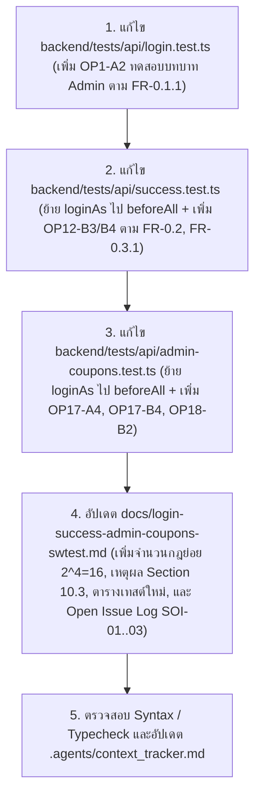

# Implementation Plan: SRS-CART-002 v1.8 Alignment for Login, Success & Admin Coupons

> **Target Executor:** Gemini Flash / Coding Agent
> **Goal:** อัปเดตไฟล์ API Tests ทั้ง 3 ไฟล์ (`login.test.ts`, `success.test.ts`, `admin-coupons.test.ts`) และเอกสารรายงานการออกแบบการทดสอบ (`docs/login-success-admin-coupons-swtest.md`) ให้สอดคล้องกับ `SRS-CART-002_v1.8_pubs.md` (รวมถึง Section 9 Open Issues และ Section 10.3 เฉลย Decision Table ของอาจารย์) แบบ 100%



---

## กฎเหล็กสำหรับผู้ดำเนินการ (Execution Constraints)
1. **No Partial Execution:** ต้องทำครบทั้ง **4 ไฟล์** (`Task 1` ถึง `Task 4`) ห้ามข้ามหรือตัดทอนเคสใดเคสหนึ่งเด็ดขาด
2. **Surgical Changes:** แก้ไขเฉพาะส่วนที่ระบุในแผนนี้ ห้ามลบคอมเมนต์สำคัญหรือแก้ไขไฟล์อื่นนอกเหนือจากที่กำหนด
3. **Mermaid Numbering Rule:** หากมีการแก้ไขไฟล์ `.md` ทุกขั้นตอนในแผนภาพ Mermaid ต้องมีเลขลำดับกำกับเสมอ (`1. ...`, `2. ...`)

---

## Task 1: อัปเดตไฟล์ `backend/tests/api/login.test.ts`

### เหตุผลตาม SRS
- **FR-0.1.1:** *"เมื่อผู้ใช้เรียก `login(username, password)` ด้วย username และ password ที่ตรงกับบัญชีที่ลงทะเบียนไว้ล่วงหน้า ระบบต้องให้ผู้ใช้เข้าสู่ระบบ**ในบทบาทของบัญชีนั้น**"*
- เพิ่มเคส **`OP1-A2`** เพื่อพิสูจน์ว่าเมื่อเข้าสู่ระบบด้วย `admin01` ระบบคืนบทบาท `role = "admin"` ครบทั้ง 2 บทบาทหลัก (`customer` และ `admin`)

### สิ่งที่ต้องทำใน `backend/tests/api/login.test.ts`
เพิ่มเคส `OP1-A2` ต่อจาก `OP1-A1`:

```ts
    it("OP1-A2 (Rule 1: T, T) login succeeds with valid admin credentials in admin role (FR-0.1.1)", async () => {
        // Precondition -> seeded account admin01 exists
        const res = await fetch(`${baseURL}/auth/login`, {
            method: "POST",
            headers: JSON_HDR,
            body: JSON.stringify({
                username: "admin01",
                password: process.env.SEED_PASSWORD_ADMIN,
            }),
        })

        expect(res.status).toBe(200)

        const body: any = await res.json()
        expect(typeof body.data.accessToken).toBe("string")
        expect(body.data.user.username).toBe("admin01")
        expect(body.data.user.role).toBe("admin")
    })
```

---

## Task 2: อัปเดตไฟล์ `backend/tests/api/success.test.ts`

### เหตุผลตาม SRS & แนวปฏิบัติของโปรเจกต์
1. **ป้องกัน Rate Limit (`429 AUTH_RATE_LIMITED`):** ย้าย `loginAs(...)` จาก `beforeEach` ไปไว้ใน `beforeAll` เหมือนกับไฟล์ [`checkout.test.ts`](file:///d:/NTDev/SoftwareTestingCourse/group-project/software-testing-srs-cart/backend/tests/api/checkout.test.ts#L24-L30) เพราะ `/test/reset` ไม่ได้ลบ `app_users` ดังนั้น Token จึงใช้ซ้ำข้ามข้อได้โดยไม่ชน Rate Limit ของระบบ Auth
2. **FR-0.2:** *"ระบบต้องปฏิเสธ OP-2 ถึง OP-9 และ **OP-12** ถึง OP-18 ที่ไม่ได้มาจากผู้ใช้ที่ login แล้ว ด้วย `AUTH_REQUIRED`"* $\rightarrow$ เพิ่มเคส **`OP12-B3`** (`401 AUTH_REQUIRED`)
3. **FR-0.3.1:** *"ระบบต้องปฏิเสธ OP-3 ถึง OP-9 และ **OP-12** ถึง OP-14 ที่เรียกโดยผู้ใช้ที่ไม่ใช่ Customer ด้วย `AUTH_FORBIDDEN`"* $\rightarrow$ เพิ่มเคส **`OP12-B4`** (`403 AUTH_FORBIDDEN` เมื่อ `admin01` เรียก `POST /cart/continue`)

### สิ่งที่ต้องทำใน `backend/tests/api/success.test.ts`
1. เปลี่ยนการ import จาก `import { describe, it, expect, beforeEach } from "vitest"` เป็น:
   ```ts
   import { describe, it, expect, beforeAll, beforeEach } from "vitest"
   ```
2. เพิ่มตัวแปร `let ADMIN: Record<string, string>` และย้าย `loginAs` ไปไว้ใน `beforeAll`:
   ```ts
   let NORMAL: Record<string, string>
   let ADMIN: Record<string, string>

   async function loginAs(username: string, password: string | undefined) {
       const res = await fetch(`${baseURL}/auth/login`, {
           method: "POST",
           headers: JSON_HDR,
           body: JSON.stringify({ username, password }),
       })
       const body: any = await res.json()
       if (!res.ok || !body?.data?.accessToken) {
           throw new Error(`login as ${username} failed: ${res.status} ${JSON.stringify(body)}`)
       }
       return { Authorization: `Bearer ${body.data.accessToken}` }
   }

   // login once per file: logging in for every test hits the Supabase Auth rate limit.
   // /test/reset keeps app_users, so these tokens stay valid across resets.
   beforeAll(async () => {
       NORMAL = await loginAs("cus_normal", process.env.SEED_PASSWORD_CUSTOMER_NORMAL)
       ADMIN = await loginAs("admin01", process.env.SEED_PASSWORD_ADMIN)
   })

   beforeEach(async () => {
       const reset = await fetch(`${baseURL}/test/reset`, {
           method: "POST",
           headers: { "x-test-reset-token": process.env.TEST_RESET_TOKEN ?? "" },
       })
       expect(reset.status).toBe(200)
   })
   ```
3. เพิ่มเคส `OP12-B3` และ `OP12-B4` ต่อท้ายใน `describe("OP-12 continueShopping - /success page", ...)`:
   ```ts
       it("OP12-B3 continueShopping rejected when unauthenticated (FR-0.2)", async () => {
           const res = await fetch(`${baseURL}/cart/continue`, {
               method: "POST",
           })

           expect(res.status).toBe(401)
           const body: any = await res.json()
           expect(body.error.code).toBe("AUTH_REQUIRED")
       })

       it("OP12-B4 continueShopping rejected when called by Admin (FR-0.3.1)", async () => {
           const res = await fetch(`${baseURL}/cart/continue`, {
               method: "POST",
               headers: ADMIN,
           })

           expect(res.status).toBe(403)
           const body: any = await res.json()
           expect(body.error.code).toBe("AUTH_FORBIDDEN")
       })
   ```

---

## Task 3: อัปเดตไฟล์ `backend/tests/api/admin-coupons.test.ts`

### เหตุผลตาม SRS & แนวปฏิบัติของโปรเจกต์
1. **ป้องกัน Rate Limit (`429 AUTH_RATE_LIMITED`):** ย้าย `loginAs(...)` จาก `beforeEach` ไปไว้ใน `beforeAll`
2. **FR-10.1.2 (เปิด/ปิดใช้คูปอง):** เพิ่มเคส **`OP17-A4`** ทดสอบการเปลี่ยนสถานะคูปอง `SAVE10` จาก `inactive` กลับเป็น `active` เพื่อครอบคลุม Transition ขากลับ (`inactive` $\rightarrow$ `active`)
3. **FR-0.2 (`AUTH_REQUIRED`):** เพิ่มเคส **`OP17-B4`** (เรียก `POST /admin/coupons/SAVE10/status` โดยไม่ส่ง token $\rightarrow$ `401 AUTH_REQUIRED`) และ **`OP18-B2`** (เรียก `GET /admin/coupons` โดยไม่ส่ง token $\rightarrow$ `401 AUTH_REQUIRED`)
4. **SRS Section 9 (`SOI-02` Tagging):** ปรับชื่อคำอธิบายของ `OP17-B2` ให้ระบุ `[SOI-02]` ชัดเจนว่าเป็น Contract-Design Test สำหรับกรณีส่ง `status` นอกเหนือจาก enum

### สิ่งที่ต้องทำใน `backend/tests/api/admin-coupons.test.ts`
1. เปลี่ยนการ import เป็น `import { describe, it, expect, beforeAll, beforeEach } from "vitest"` และย้าย `loginAs` เข้า `beforeAll`:
   ```ts
   // login once per file: logging in for every test hits the Supabase Auth rate limit.
   // /test/reset keeps app_users, so these tokens stay valid across resets.
   beforeAll(async () => {
       NORMAL = await loginAs("cus_normal", process.env.SEED_PASSWORD_CUSTOMER_NORMAL)
       ADMIN = await loginAs("admin01", process.env.SEED_PASSWORD_ADMIN)
   })

   beforeEach(async () => {
       const reset = await fetch(`${baseURL}/test/reset`, {
           method: "POST",
           headers: { "x-test-reset-token": process.env.TEST_RESET_TOKEN ?? "" },
       })
       expect(reset.status).toBe(200)
   })
   ```
2. เพิ่มเคส `OP17-A4` ต่อจาก `OP17-A3`:
   ```ts
       it("OP17-A4 (FR-10.1.2) admin re-enables coupon SAVE10 back to active", async () => {
           await fetch(`${baseURL}/admin/coupons/SAVE10/status`, {
               method: "POST",
               headers: { ...ADMIN, ...JSON_HDR },
               body: JSON.stringify({ status: "inactive" }),
           })

           const res = await fetch(`${baseURL}/admin/coupons/SAVE10/status`, {
               method: "POST",
               headers: { ...ADMIN, ...JSON_HDR },
               body: JSON.stringify({ status: "active" }),
           })

           expect(res.status).toBe(200)
           const body: any = await res.json()
           const save10 = body.data.coupons.find((c: any) => c.code === "SAVE10")
           expect(save10.status).toBe("active")
       })
   ```
3. อัปเดตชื่อ `OP17-B2` ให้มี `[SOI-02]` และเพิ่ม `OP17-B4` กับ `OP18-B2` ต่อท้ายไฟล์:
   ```ts
       it("OP17-B2 [SOI-02] validation error when status is invalid enum (VALIDATION_ERROR)", async () => {
           const res = await fetch(`${baseURL}/admin/coupons/SAVE10/status`, {
               method: "POST",
               headers: { ...ADMIN, ...JSON_HDR },
               body: JSON.stringify({ status: "disabled" }),
           })

           expect(res.status).toBe(400)
           const body: any = await res.json()
           expect(body.error.code).toBe("VALIDATION_ERROR")
       })
   ```
   และต่อท้ายหลังจาก `OP18-B1`:
   ```ts
       it("OP17-B4 unauthenticated user cannot change coupon status (FR-0.2)", async () => {
           const res = await fetch(`${baseURL}/admin/coupons/SAVE10/status`, {
               method: "POST",
               headers: JSON_HDR,
               body: JSON.stringify({ status: "inactive" }),
           })

           expect(res.status).toBe(401)
           const body: any = await res.json()
           expect(body.error.code).toBe("AUTH_REQUIRED")
       })

       it("OP18-B2 unauthenticated user cannot list admin coupons (FR-0.2)", async () => {
           const res = await fetch(`${baseURL}/admin/coupons`)

           expect(res.status).toBe(401)
           const body: any = await res.json()
           expect(body.error.code).toBe("AUTH_REQUIRED")
       })
   ```

---

## Task 4: อัปเดตเอกสาร `docs/login-success-admin-coupons-swtest.md`

### เหตุผลตาม SRS Section 9 & Section 10.3
1. **Section 1.3 (`calculateDiscount` Decision Table):**
   - เพิ่มคอลัมน์ **"จำนวนกฎย่อยที่ครอบคลุม"** ในตาราง Decision Table (`2 + 1 + 1 + 2 + 2 + 4 + 4 = 16 = 2^4`) ให้ตรงกับเฉลยของอาจารย์ใน **SRS Section 10.3**
   - เพิ่มคำอธิบายว่า **ทำไม Rule 2 กับ Rule 4 (และ Rule 3 กับ Rule 5) ซึ่งมี Action เหมือนกัน (`A2, A3` และ `A2, A4`) ถึงยุบรวมเป็นคอลัมน์เดียวไม่ได้** (เพราะเงื่อนไขที่ทำให้คูปองใช้ไม่ได้คือ `C2 = F` **หรือ** `C3 = F` ซึ่งตารางแบบ Limited-Entry หนึ่งคอลัมน์ไม่สามารถแสดงความสัมพันธ์แบบ OR ได้โดยไม่ทับซ้อนกับกรณี `T, T, T`)
2. **Section 1, 2, 3 ของ API Test:**
   - เพิ่มแถว `OP1-A2` ในตารางของ `OP-1 login`
   - เพิ่มการอ้างอิง **FR-0.2**, **FR-0.3.1** และแถว `OP12-B3`, `OP12-B4` ในตารางของ `OP-12 continueShopping`
   - เพิ่มการอ้างอิง **FR-0.2** และแถว `OP17-A4`, `OP17-B4`, `OP18-B2` พร้อมกำกับ `[SOI-02]` ที่ `OP17-B2` ในตารางของ `OP-17 / OP-18`
3. **เพิ่มหัวข้อใหม่ท้ายเอกสาร: `Open Issue Log (ตามกติกา SRS Section 9)`:**
   - บันทึก **`SOI-01`** (รหัสผ่านของบัญชี Seed ใน `OP-1`), **`SOI-02`** (การส่งค่า `status` ผิด enum ใน `OP-17`), และ **`SOI-03`** (ขอบเขตของ `DC-2.13` Stage Guard บนหน้า Workflow `/cart`, `/checkout`, `/success` เทียบกับหน้าอ่านข้อมูลตาม `FR-8.5.2`) ให้ตรงกับ [`docs/spec/01-decisions-and-gaps.md`](file:///d:/NTDev/SoftwareTestingCourse/group-project/software-testing-srs-cart/docs/spec/01-decisions-and-gaps.md)

### สิ่งที่ต้องทำใน `docs/login-success-admin-coupons-swtest.md`
1. **ในหัวข้อ `1.3 คิด Test Case ยังไง (Step-by-step)` ของ Unit Test (`calculateDiscount`):**
   - เพิ่มข้อย่อยใน **ขั้นที่ 2**:
     - ระบุว่าผลรวมของกฎย่อยที่ยุบรวมแล้วคือ $2 + 1 + 1 + 2 + 2 + 4 + 4 = 16 = 2^4$ กฎครบถ้วน
     - อธิบายว่า **Rule 2 กับ Rule 4** (ได้ `A2, A3` เหมือนกัน) และ **Rule 3 กับ Rule 5** (ได้ `A2, A4` เหมือนกัน) **ไม่สามารถยุบรวมเป็นคอลัมน์เดียวกันได้** เนื่องจากเงื่อนไขการถอดคูปองเกิดจาก `C2 = F` **หรือ** `C3 = F` ซึ่งตารางตัดสินใจแบบ Limited-Entry หนึ่งคอลัมน์แสดงได้เฉพาะเงื่อนไขที่เชื่อมด้วย `AND` เท่านั้น
   - อัปเดตตาราง Decision Table ให้มีคอลัมน์ `จำนวนกฎย่อยที่ครอบคลุม`:
     ```markdown
     | Rule | C1 (มีคูปอง) | C2 (เปิดใช้) | C3 ($\ge$ minSpend) | C4 (Prime) | Action | จำนวนกฎย่อยที่ครอบคลุม |
     | --- | --- | --- | --- | --- | --- | --- |
     | 1 | T | T | T | - | A1 | 2 |
     | 2 | T | T | F | T | A2, A3 | 1 |
     | 3 | T | T | F | F | A2, A4 | 1 |
     | 4 | T | F | - | T | A2, A3 | 2 |
     | 5 | T | F | - | F | A2, A4 | 2 |
     | 6 | F | - | - | T | A3 | 4 |
     | 7 | F | - | - | F | A4 | 4 |
     ```
2. **ในหัวข้อ `API Test > 1. OP-1 login`:**
   - ในตาราง Test Cases เพิ่มแถว `OP1-A2` ต่อจาก `OP1-A1`:
     ```markdown
     | OP1-A2 | POST /auth/login | Rule 1 (T, T): login สำเร็จด้วยบัญชี Admin ได้บทบาทตรงตามบัญชี (FR-0.1.1) | มีบัญชี seed `admin01` ในระบบ | body: `{"username":"admin01","password":"<SEED_PASSWORD_ADMIN>"}` | 200 + `data.accessToken` เป็น string, `data.user.username = "admin01"`, `data.user.role = "admin"` |
     ```
3. **ในหัวข้อ `API Test > 2. OP-12 continueShopping`:**
   - ใน `2.1 FR ที่เกี่ยวข้อง` เพิ่ม **FR-0.2** (`AUTH_REQUIRED`) และ **FR-0.3.1** (`AUTH_FORBIDDEN` เมื่อไม่ใช่ Customer)
   - ในตาราง Test Cases เพิ่มแถว `OP12-B3` และ `OP12-B4`:
     ```markdown
     | OP12-B3 | POST /cart/continue | เรียก `continueShopping` โดยไม่ได้ login (FR-0.2) | ไม่ได้ส่ง Authorization token | header: ไม่มี | 401 + `error.code = "AUTH_REQUIRED"` |
     | OP12-B4 | POST /cart/continue | Admin เรียก `continueShopping` ของ Customer (FR-0.3.1) | `admin01` login แล้ว | header: token `admin01` | 403 + `error.code = "AUTH_FORBIDDEN"` |
     ```
4. **ในหัวข้อ `API Test > 3. OP-17 setCouponStatus และ OP-18 listCoupons`:**
   - ใน `3.1 FR ที่เกี่ยวข้อง` เพิ่ม **FR-0.2** (`AUTH_REQUIRED`)
   - ใน `3.3 ขั้นที่ 1` ตรง `S2 (Invalid)` ระบุกำกับว่า `(**SOI-02**: SRS Section 5 ไม่ได้ระบุรหัสข้อผิดพลาดของ status ผิด enum ใน FR-10.1 จึงกำหนดใน API Contract เป็น VALIDATION_ERROR ตามกติกา Section 9)`
   - ในตาราง Test Cases เพิ่ม `OP17-A4`, ปรับคำอธิบาย `OP17-B2` ให้มี `[SOI-02]`, และเพิ่ม `OP17-B4`, `OP18-B2`:
     ```markdown
     | OP17-A4 | POST /admin/coupons/SAVE10/status | Admin เปิดใช้คูปอง SAVE10 กลับมาเป็น active (FR-10.1.2) | `admin01` ตั้ง `SAVE10` เป็น `inactive` แล้ว | header: token `admin01`; body: `{"status":"active"}` | 200 + `data.coupons` แสดง `SAVE10` มี `status = "active"` |
     | OP17-B2 | POST /admin/coupons/SAVE10/status | `[SOI-02 / Contract]` ส่งค่า status ที่ไม่อยู่ใน enum | `admin01` login แล้ว | header: token `admin01`; body: `{"status":"disabled"}` | 400 + `error.code = "VALIDATION_ERROR"` |
     | OP17-B4 | POST /admin/coupons/SAVE10/status | เรียกตั้งสถานะคูปองโดยไม่ได้ login (FR-0.2) | ไม่ได้ส่ง Authorization token | header: ไม่มี; body: `{"status":"inactive"}` | 401 + `error.code = "AUTH_REQUIRED"` |
     | OP18-B2 | GET /admin/coupons | เรียกดูรายการคูปองโดยไม่ได้ login (FR-0.2) | ไม่ได้ส่ง Authorization token | header: ไม่มี | 401 + `error.code = "AUTH_REQUIRED"` |
     ```
5. **เพิ่มส่วนท้ายเอกสาร `# Open Issue Log (ตามกติกา SRS Section 9)`:**
   ```markdown
   ---

   # Open Issue Log (ตามกติกา SRS Section 9)

   ตามข้อกำหนดใน **SRS-CART-002 v1.8 ส่วนที่ 9 (Open Issues / Specification Gaps)** จุดที่เอกสาร SRS ไม่ได้ระบุพฤติกรรมไว้โดยตรง จะถูกบันทึกเป็นรหัส `SOI-n` และแยกการตรวจสอบระดับ API Contract ออกจากค่าคาดหวังตาม SRS ดังนี้:

   | รหัส | ประเด็นที่ SRS ไม่ได้กำหนด (Specification Gap) | แนวทางจัดการและการออกแบบ (Disposition) | นโยบายการทดสอบ (Test Policy) |
   | --- | --- | --- | --- |
   | **SOI-01** | SRS ส่วนที่ 7 ระบุรายชื่อบัญชีผู้ใช้ตั้งต้น (`cus_normal`, `cus_prime`, `admin01`) แต่ไม่ได้ระบุรหัสผ่านของแต่ละบัญชี | กำหนดรหัสผ่านผ่านตัวแปรสภาพแวดล้อม (`SEED_PASSWORD_*`) สำหรับสภาพแวดล้อมทดสอบ | ทดสอบ `OP-1 login` โดยดึงรหัสผ่านที่ถูกต้องจาก Environment Variable โดยไม่อ้างอิงค่าคงที่ตายตัวว่าเป็นข้อกำหนดจาก SRS |
   | **SOI-02** | ใน `OP-17 setCouponStatus(code, status)` (**FR-10.1**) และตารางที่ 5 ไม่ได้ระบุรหัสข้อผิดพลาดและลำดับการตรวจเมื่อส่ง `status` ที่ไม่อยู่ใน enum (`เปิดใช้` / `ปิดใช้`) | ตรวจว่ามีรหัสคูปองอยู่ในระบบก่อน (`COUPON_NOT_FOUND` ตาม **FR-10.1.1**) หากมีคูปองแต่ `status` ไม่อยู่ใน `['active', 'inactive']` ให้คืน `400 VALIDATION_ERROR` พร้อม `details.fields = ['status']` | แยกเคส `OP17-B2` เป็นการทดสอบระดับ API Contract (`[SOI-02]`) โดยไม่นำไปปะปนเป็น SRS Expected Oracle |
   | **SOI-03** | **DC-2.13** ระบุว่าเมื่อ Customer เปิด URL ที่ไม่ตรงกับ `stage` ปัจจุบันต้องแสดงหน้าที่ตรงกับ `stage` แต่ **FR-8.5.2** กำหนดให้ `listProducts`, `listOrders`, `viewOrder` ทำงานได้ในทุก `stage` | บังคับใช้ `StageGuard` เฉพาะกลุ่มหน้า Workflow ที่ผูกกับ `stage` โดยตรง ได้แก่ `/cart`, `/checkout`, และ `/success` ส่วนหน้าอ่านข้อมูล (`/products`, `/orders`, `/orders/:orderId`) เปิดดูได้ทุก `stage` | ทดสอบ `E2E-SUCCESS-2` (เปิด `/cart` ขณะอยู่ stage `สำเร็จ` แล้วถูกบังคับไปหน้า `page-success`) ภายในขอบเขตหน้า Workflow ที่ชัดเจนตาม **DC-2.13** |
   ```

---

## Verification Steps (ขั้นตอนตรวจสอบหลังแก้ไขเสร็จ)

1. **检查 Unit Test (`packages/domain`):**
   ```powershell
   npm.cmd --prefix packages/domain test -- --run tests/pricing.test.ts
   ```
   - **Verify:** ต้องผ่านครบ `21 passed (21)`
2. **ตรวจ TypeScript / Syntax ของไฟล์เทสต์ที่แก้ไข:**
   - ตรวจสอบว่าไม่มี Syntax Error หรือการ import ซ้ำซ้อนใน `backend/tests/api/login.test.ts`, `backend/tests/api/success.test.ts`, และ `backend/tests/api/admin-coupons.test.ts`
3. **อัปเดต `.agents/context_tracker.md`:**
   - บันทึกสถานะ `COMPLETED` และรายชื่อไฟล์ทั้ง 4 ไฟล์ที่แก้ไขลงใน `.agents/context_tracker.md`
