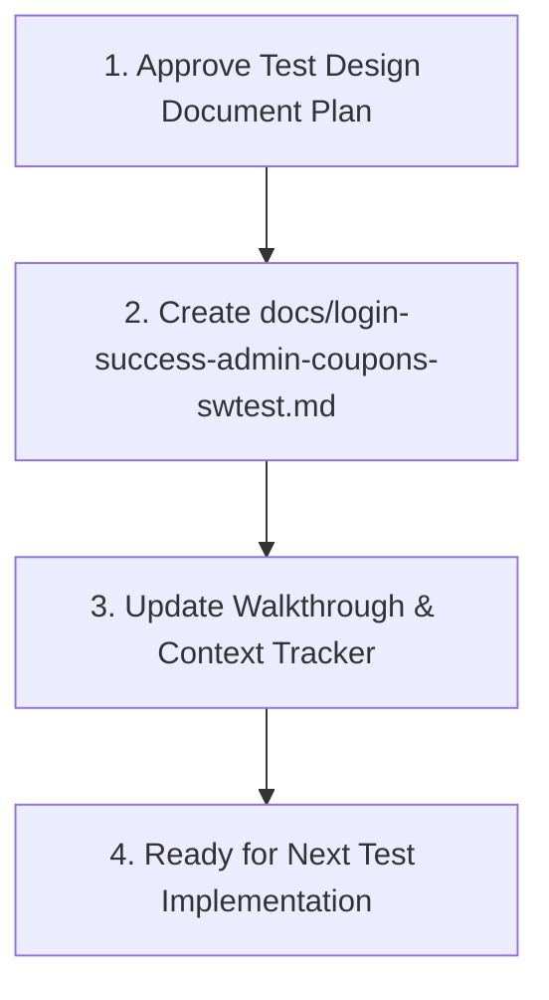

# Active Task: Create Test Design Specification Document (docs/login-success-admin-coupons-swtest.md)
- Status: COMPLETED
- Architecture & Decisions:
  - Created `docs/login-success-admin-coupons-swtest.md` matching the teammate's Notion export format (`# Unit Test`, `# API Test`, `# E2E`) while embedding explicit sections for:
    1. ดูจาก FR ไหน / Function อะไร / AC ไหน (Traceability)
    2. ใช้เทคนิคอะไร และทำไม (Testing Technique & Rationale)
    3. คิด Test Case ยังไง (Step-by-step Derivation)
- Modified Files:
  - docs/login-success-admin-coupons-swtest.md
  - backend/tests/api/login.test.ts
  - .agents/context_tracker.md
- Blocker / Assumptions: None.
- Next Step: Implement remaining API tests (`OP-12 continueShopping`, `OP-17 setCouponStatus`, `OP-18 listCoupons`) and Playwright E2E tests (`e2e/login.spec.ts`, `e2e/success.spec.ts`, `e2e/admin-coupons.spec.ts`) when user requests.

