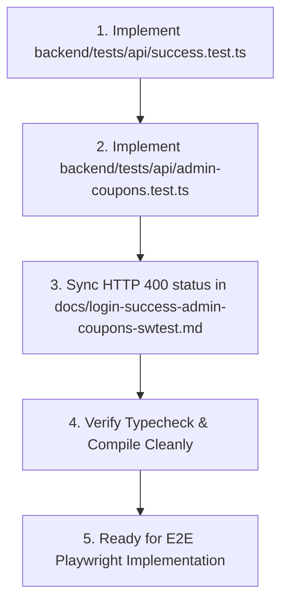

# Active Task: Completed API Tests for /success and /admin/coupons
- Status: COMPLETED
- Architecture & Decisions:
  - Created `backend/tests/api/success.test.ts` covering OP-12 (`OP12-A1`, `OP12-B1`, `OP12-B2`).
  - Created `backend/tests/api/admin-coupons.test.ts` covering OP-17 & OP-18 (`OP17-A1`, `OP17-A2`, `OP17-A3`, `OP17-B1`, `OP17-B2`, `OP17-B3`, `OP18-A1`, `OP18-B1`).
  - Synced HTTP 400 for `OPERATION_NOT_ALLOWED` in `docs/login-success-admin-coupons-swtest.md` with backend implementation.
  - Verified TypeScript compilation.
- Modified Files:
  - backend/tests/api/success.test.ts
  - backend/tests/api/admin-coupons.test.ts
  - docs/login-success-admin-coupons-swtest.md
  - .agents/context_tracker.md
- Blocker / Assumptions: Integration tests require live test backend (`APP_ENV=test`) at localhost:3001.
- Next Step: Proceed to E2E Tests (Playwright) for `/login`, `/success`, and `/admin/coupons`.

