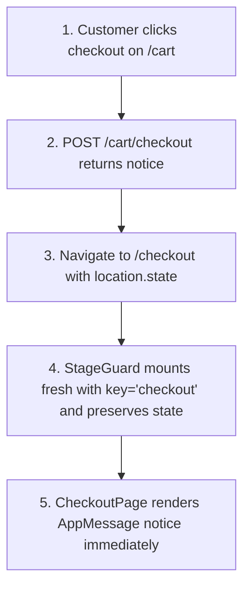

# Active Task: Fix Checkout Page Notice Loss & StageGuard Re-render in admin-coupons.spec.ts

- Status: COMPLETED
- Architecture & Decisions:
  1. Identified that React Router was reusing the `<StageGuard>` instance across `/cart` -> `/checkout` without a key, causing `StageGuard` to initialize with stale `stage = "cart"`, redirect back to `/cart` and strip `location.state` (which contained the `COUPON_NOT_APPLICABLE` notice).
  2. Added unique keys (`key="cart"`, `key="checkout"`, `key="success"`) in `App.tsx` and ensured `StageGuard` passes `state={location.state}` during any replace navigation.
  3. Updated `CheckoutPage` to keep `message` in sync with `location.state` and render `message` during the loading order state so that the notice banner is visible without race conditions.
  4. Added `await expect(page.getByTestId('checkout-order-id')).toBeVisible()` in `admin-coupons.spec.ts` to ensure snapshot synchronization.
- Modified Files:
  - `frontend/src/App.tsx`
  - `frontend/src/components/stage-guard.tsx`
  - `frontend/src/pages/checkout.tsx`
  - `e2e/admin-coupons.spec.ts`
- Blocker / Assumptions: None.
- Next Step: Instruct user to re-run `admin-coupons.spec.ts`.
