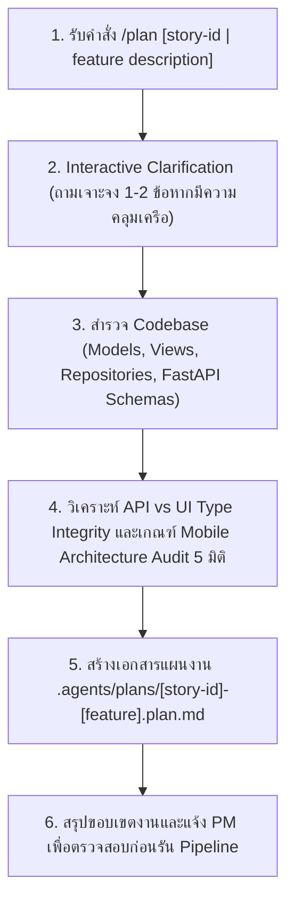
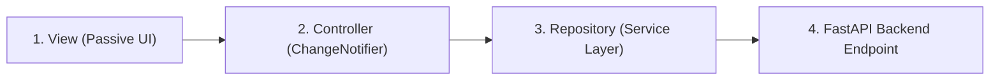

# Implementation Plan Generator

**Input**: $ARGUMENTS

## Objective

แปลงโจทย์ความต้องการหรือ User Story ให้กลายเป็นแผนงานเชิงสถาปัตยกรรม (Implementation Plan) ที่พร้อมให้ Sub-agents (Spoke 2, Spoke 3, Spoke 4) นำไปพัฒนาต่อได้ทันที 100% โดยอาศัยหลักการ **Interactive Clarification** จาก `prompt-architect.md` และมาตรฐานการตรวจสอบสถาปัตยกรรมมือถือจาก [`.agents/skills/mobile-audit.md`](file:///d:/NTDev/MobileCourse/KUSRC%20Nisit%20Academic%20Request%20%28KU-AR%29/.agents/skills/mobile-audit.md)

**Core Principle**: PLAN ONLY - ห้ามเริ่มเขียนโค้ดฟีเจอร์จนกว่าแผนจะได้รับการเห็นชอบ

---

## Workflow Diagram



---

## Phase 1: PARSE & INTERACTIVE CLARIFICATION

### 1.1 Determine Input Type

| Input | การดำเนินการ |
|---|---|
| `story-XX` | ค้นหาข้อมูลจาก `.agents/stories/STORIES_register-15.md` หรือ Jira Issue |
| `.prd.md` | อ่านเอกสาร PRD ดึง Requirements และ Success Criteria |
| Free-form text | ใช้ข้อความโจทย์เป็น Feature Input |

### 1.2 Interactive Clarification (Prompt Architect Protocol)

หากตรวจพบว่าความต้องการหรือบริบททางเทคนิคยังไม่สมบูรณ์ **ห้ามคาดเดาเองเด็ดขาด** ให้หยุดและใช้เครื่องมือ `ask_question` เพื่อสอบถาม PM เจาะจง 1-2 คำถาม:
- **Target Flow & Edge Cases**: หน้าจอนี้มีเงื่อนไข Validation, `maxLength`, `TextInputFormatter` หรือ Edge Cases อะไรเป็นพิเศษหรือไม่?
- **Data Contract**: ข้อมูลนี้มี Backend Endpoint รองรับแล้ว หรือต้องสร้าง Endpoint ใหม่ใน FastAPI?
- *(หมายเหตุ: หาก PM ระบุบริบทครบถ้วนชัดเจนแล้ว ให้ข้ามขั้นตอนนี้และเริ่มวิเคราะห์ Codebase ทันที)*

---

## Phase 2: EXPLORE CODEBASE PATTERNS

สำรวจ Codebase ของ KU-AR เพื่อจับ Pattern ที่มีอยู่เดิม:

1. **Presentation Patterns**: ดูโครงสร้าง Widget และ View ใน `ku_ar_mobile/lib/views/`
2. **State & Controllers**: ดูการใช้ `ChangeNotifier` และ `Provider` ใน `ku_ar_mobile/lib/controllers/`
3. **Data Repositories**: ดู Interfaces และ Implementation ใน `ku_ar_mobile/lib/services/repositories/`
4. **Backend Contracts**: ดู Pydantic Schemas ใน `backend_fastapi/app/schemas.py`
5. **Testing Patterns**: ดู Unit & Widget Tests ใน `ku_ar_mobile/test/`

---

## Phase 3: ARCHITECTURE, TYPE GUARD & MOBILE AUDIT DESIGN

### 3.1 Delivery Checklist (API vs UI Integrity)
- กำหนด Type ของทุกฟิลด์ให้ตรงกันระหว่าง Python (Pydantic) และ Dart
- ระบุฟิลด์ที่ต้องเป็น Nullable (`?`) ป้องกัน `_CastError`

### 3.2 UI States Matrix
- กำหนดพฤติกรรมของหน้าจอในทั้ง 4 สเตตัส: Initial, Loading, Empty, และ Error (พร้อมปุ่มลองใหม่)

### 3.3 Mobile Architecture & Code Quality Audit Checklist (`mobile-audit.md` 5 มิติ)
ทุกแผนงานที่มีการสร้างหรือแก้ไขหน้าจอ Flutter (`lib/views/`) **ต้องระบุข้อกำหนดทั้ง 5 มิตินี้ลงในแผนเสมอ**:
1. **Form, Input Validation & UX Constraints**:
   - ใช้ `TextFormField` ผูกกับ `GlobalKey<FormState>` สำหรับทุกช่องที่ต้อง Validate
   - ระบุ `maxLength` ที่เหมาะสมทุกช่อง (เช่น ช่องเหตุผล/ความเห็น `maxLength: 500` เพื่อป้องกันข้อความล้นกรอบ PDF `register-15`, รหัสนิสิต `maxLength: 10`, หมู่เรียน `maxLength: 4`)
   - ระบุ `keyboardType` และ `inputFormatters` ให้ตรงประเภทข้อมูล:
     - ตัวเลขล้วน (รหัสนิสิต, หมู่เรียน): `FilteringTextInputFormatter.digitsOnly`
     - เบอร์โทรศัพท์: ใช้ `ThaiPhoneInputFormatter` (กรอกเฉพาะตัวเลข แต่แสดงผลและส่งค่า Output เป็น `0XX-XXX-XXXX`)
   - กำหนด `textInputAction` (`TextInputAction.next` / `TextInputAction.done`) และห่อหุ้มหน้าจอด้วย `GestureDetector(onTap: () => FocusScope.of(context).unfocus())` เพื่อปิดคีย์บอร์ดเมื่อแตะพื้นที่ว่าง
2. **Memory & Lifecycle Safety**:
   - ทุก `TextEditingController`, `FocusNode`, และ `ScrollController` ต้องถูกทำลายใน `dispose()`
   - ทุกการทำงานหลัง `await` ใน `StatefulWidget` ต้องเช็ก `if (!mounted) return;` ก่อนเรียกใช้ `context` หรือ `setState`
3. **Responsive Layout & Overflow Prevention**:
   - หน้าจอที่มีฟอร์มต้องรองรับการเลื่อนเมื่อคีย์บอร์ดเด้ง (`SingleChildScrollView` / `ListView`) และห้ามฮาร์ดโค้ดขนาดความกว้างจนเกิด `RenderFlex overflowed`
4. **Modular Widget Tree & Clean MVC Separation**:
   - ห้ามใส่ Business Logic, API Call, หรือฝังชุดข้อมูล Mock ขนาดใหญ่ไว้ในไฟล์ View (ให้แยกไปไว้ที่ Controller/Service หรือ `mock_fallback_data.dart`)
5. **Performance Optimization**:
   - บังคับใช้ `const` constructors กับ Static Widgets และใช้ `ListView.builder` สำหรับรายการแบบไดนามิก

---

## Phase 4: GENERATE PLAN ARTIFACT

สร้างไฟล์แผนงานที่ `.agents/plans/[story-id]-[feature-name].plan.md`:

```markdown
# Plan: [Story-ID] — [Feature Name]

## Summary
{สรุปเป้าหมายของฟีเจอร์และแนวทางการพัฒนา 1 ย่อหน้า}

## User Story & Acceptance Criteria
- **User Story**: As a [user], I want to [action], so that [benefit]
- **Jira Issue**: [Issue Key เช่น MDUCP-10]
- **Acceptance Criteria**:
  - AC-1: Given ..., When ..., Then ...
  - AC-2: Given ..., When ..., Then ...

## Architecture & Data Flow


## Mobile Audit & Input Constraints Specification
| Field / Component | Constraint (`maxLength`, `inputFormatters`, `keyboardType`, Lifecycle) |
|---|---|
| ... | ... |

## Files to Change

| File Path | Action | Description |
|---|---|---|
| `ku_ar_mobile/lib/models/...` | CREATE | Data Model matching backend schema |
| `ku_ar_mobile/lib/services/...` | CREATE | Repository interface and implementation |
| `ku_ar_mobile/lib/controllers/...` | CREATE | State controller |
| `ku_ar_mobile/lib/views/...` | CREATE | Passive UI View & widgets |
| `ku_ar_mobile/test/...` | CREATE | Unit & Widget test cases |

## Validation & Test Plan
- Flutter Static Analysis: `flutter analyze` (0 errors)
- Automated Tests: `flutter test` (100% pass)
```

---

## Phase 5: OUTPUT DIGEST

สรุปผลการสร้างแผนงานให้ PM ทราบ:
1. **ไฟล์ Plan ที่สร้าง**: Path ของไฟล์ใน `.agents/plans/`
2. **ขอบเขตการแก้ไข**: จำนวนไฟล์ที่จะ CREATE และ UPDATE
3. **ขั้นตอนถัดไป**: แจ้ง PM ให้เรียกใช้ `@[.agents/commands/run-story.md] [story-id]` เพื่อเริ่มดำเนินการอัตโนมัติ
