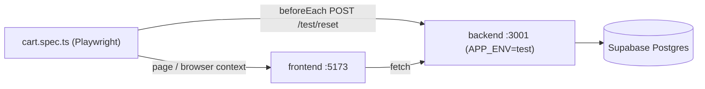

# Plan: E2E-CART — Cart Page (`page-cart`) Playwright Tests

## Summary
เขียน Playwright spec `e2e/cart.spec.ts` ให้ครอบคลุม 16 test case (TC-01 ถึง TC-16) ใน 6 scenario ตามเอกสาร `docs/test-design/e2e-cart-page-test-design.md` (SRS-CART-002 v1.8, DC-2) งานนี้เพิ่มไฟล์เทสอย่างเดียว ไม่แก้ frontend หรือ backend โดย 1 scenario = 1 `test()` และแต่ละ TC เป็น `test.step()` ข้างใน เพื่อให้ login แค่ครั้งเดียวต่อ scenario (Supabase Auth มี rate limit) แต่ละ test เรียก `/test/reset` ใน `beforeEach` ตามแบบของ `e2e/checkout.spec.ts`

## User Story & Acceptance Criteria
- **User Story**: ในฐานะทีมทดสอบ ฉันต้องการ E2E test อัตโนมัติของหน้ารถเข็น เพื่อยืนยันว่า UI ทำงานตาม FR-1.x, FR-2.5–2.9, FR-3.x, FR-9.3.4 บน browser จริง
- **Branch**: `test/e2e-cart-page` (แตกจาก `main` @ 9462d59)
- **Acceptance Criteria**:
  - AC-1: Given backend (`APP_ENV=test`, :3001) และ frontend (:5173) รันอยู่, When รัน `cd e2e && npx playwright test cart.spec.ts`, Then 6 test ผ่านทั้งหมด
  - AC-2: Given ไฟล์ spec, When รัน `npm run typecheck` ใน `e2e/`, Then ไม่มี error
  - AC-3: ชื่อ step ทุกอันขึ้นต้นด้วย TC-ID ตามเอกสาร เพื่อ trace กลับไปที่ RTM ได้

## Architecture & Data Flow

ข้อมูล seed หลัง reset: P1 450 บ. สต็อก 20, P2 1,200 บ. สต็อก 3, P3 15,000 บ. สต็อก 5 (ทุกตัว onSale), คูปอง `SAVE10` active

## Helper ภายในไฟล์ (ไม่สร้างไฟล์ helper แยก ตามแบบ spec เดิม)

| Helper | หน้าที่ |
|---|---|
| `login(page, user)` | `/login` → กรอก `login-username` / `login-password` → `login-submit` → รอ `page-products` (customer) หรือ `page-admin-products` (admin) |
| `addFromProducts(page, productId, qty)` | ที่ `product-row-{id}` กรอก `product-add-qty` แล้วกด `product-add-button` และรอ response `POST /cart/items` 200 (หน้าสินค้าไม่แสดงข้อความเมื่อสำเร็จ จึงต้องรอ response แทน) |
| `openCart(page)` | กด `nav-cart` → รอ `page-cart` |
| `line(page, id)` | `page.getByTestId('cart-line-' + id)` |

## Scenario → Test Mapping

| test() | Steps (ตามลำดับ) | Setup |
|---|---|---|
| E2E-CART-1 | TC-01 → TC-02 | login cus_normal → `nav-cart` (ตะกร้าว่าง) |
| E2E-CART-2 | TC-03 → TC-04 → (add P2 × 1) → TC-05 → TC-06 | add P1 × 1 |
| E2E-CART-3 | TC-11 → TC-13 | add P1 × 1, P2 × 1 |
| E2E-CART-4 | TC-08 → TC-09 → TC-07 → TC-10 | add P1 × 1 |
| E2E-CART-5 | TC-12 | add P1 × 1, P2 × 1; admin ปิดขาย P1 ใน browser context แยก |
| E2E-CART-6 | TC-14 → TC-15 → TC-16 | add P1 × 1 + ผูก SAVE10 |

## จุดที่ต้องปรับจากเอกสาร (ตรวจกับ `frontend/src/pages/cart.tsx` แล้ว)

| ประเด็น | ในเอกสาร | ที่จะทำในโค้ด |
|---|---|---|
| ยอดรวมต่อแถว (TC-03, TC-05) | ไม่ระบุ locator | ไม่มี test-id จึงใช้ `row.locator('.line-total-amount')` เช็ค `data-value` และข้อความ `"900 บาท"` / `"3,600 บาท"` |
| `cart-subtotal` ใน TC-05 | "อัปเดตถูกต้อง" | ระบุค่าเป็น `4050` (P1 × 1 = 450 + P2 × 3 = 3,600) |
| ลำดับ TC ใน CART-4 | TC-07 → 08 → 09 → 10 | รัน TC-08 และ TC-09 ก่อน TC-07 เพราะ TC-08 ต้องการ precondition "ยังไม่ได้ผูกคูปอง" |
| ปุ่ม `+` / `-` | `aria-label` | `row.getByRole('button', { name: 'เพิ่มจำนวน' / 'ลดจำนวน' })` |
| Precondition TC-12 | "P1 ถูกแอดมินปิดขาย" | `browser.newContext()` → login admin01 → `admin-product-row-P1` › `admin-product-toggle-status` → รอ `admin-product-status` มี `data-status="offSale"` แล้ว reload `/cart` ของลูกค้า และเช็ค `data-available="false"` ก่อนลบ (ไม่ยิง admin API ตรง ๆ เพราะ admin route ตรวจ Origin) |
| "ป้ายเตือนสีแดงหายไป" (TC-12) | ไม่ระบุ locator | `getByText('สินค้านี้หมดชั่วคราว')` ต้อง `toHaveCount(0)` |
| TC-13 info message | `"ตะกร้าว่าง"` | `app-message` มี `data-kind="info"` และ `toContainText('ตะกร้าว่าง')` |
| TC-14 การเลือกตัวเลือก | เลือกตาม label | `selectOption({ label: 'ต่างจังหวัด' })` แล้ว `toHaveValue('upcountry')` |
| TC-15 Logout | "คลิก Logout" | `logout-button` → รอ `page-login` → login ใหม่ |
| RTM `FR-9.2.1` → TC-03 | TC-03 ไม่มีการแก้ราคาโดยแอดมิน | ไม่เพิ่ม TC ในรอบนี้ แค่แจ้งว่า RTM แถวนี้อ้าง TC ไม่ตรง (ถ้าต้องการให้เพิ่ม step แก้ราคา P1 ใน CART-5 ภายหลัง) |

## UI States ที่ครอบคลุม
- **Initial/Empty**: TC-01, TC-13 (`"ยังไม่มีสินค้าในรถเข็น"`, subtotal 0, checkout disabled)
- **Loading**: รอ element/attribute ด้วย web-first assertion แทน `waitForTimeout`
- **Error**: TC-06 (`INSUFFICIENT_STOCK`), TC-08/09/10 (`COUPON_INVALID`)
- **Unavailable line**: TC-12 (`data-available="false"`)

## Mobile Audit & Input Constraints Specification
ไม่เกี่ยวกับงานนี้ (โปรเจกต์นี้เป็นเว็บ React + Playwright ไม่มีหน้าจอ Flutter และงานนี้ไม่แก้ UI)

## Files to Change

| File Path | Action | Description |
|---|---|---|
| `e2e/cart.spec.ts` | CREATE | 6 test / 16 step ตามตารางด้านบน |
| `e2e/README.md` | — | ไม่แก้ (`npm test` รันทุก `*.spec.ts` อยู่แล้ว) |

## Follow-up: `/test/reset` 503 ก่อน E2E-CART-4 / E2E-CART-6 (2026-11-05)

### อาการ
รันทั้งไฟล์แล้ว test ที่อยู่ถัดจาก E2E-CART-3 และ E2E-CART-5 fail ใน `beforeEach` (`reset.status()` = 503 `TEST_RESET_FAILED`) ภายใน ~1.4 วินาที โดยยังไม่ได้เข้าตัว test เลย แต่รันแยกแล้วผ่านทุกตัว

### หลักฐาน
- `pg_stat_database.deadlocks` เพิ่มจาก 12 เป็น 14 ระหว่างรันรอบเดียว ตรงกับจำนวน reset ที่ fail (2 ครั้ง)
- ทั้ง E2E-CART-3 และ E2E-CART-5 จบด้วยการกด `cart-line-remove` ทุก cart mutation ใน `frontend/src/lib/api-client.ts` จะยิง `CART_CHANGED_EVENT` แล้ว `useCartLineCount` (`frontend/components/commerce/shell.tsx`) ส่ง `GET /cart` ตามไปทันที assertion สุดท้ายผ่านจาก DOM ที่อัปเดตจาก response ของ remove ทำให้ test จบทั้งที่ `GET /cart` ยังรันอยู่ฝั่ง server
- reset ใช้ `TRUNCATE cart_lines, …, customer_state, …` ซึ่งล็อกตาราง ACCESS EXCLUSIVE ตามลำดับนี้ ส่วน transaction ของ cart ล็อก `customer_state` ก่อนแล้วค่อยอ่าน `cart_lines` ลำดับสวนกันจึง deadlock ได้ และ Postgres เลือก abort ฝั่ง reset → 503
- ลอง reproduce ด้วยสคริปต์ยิง API ตรง ๆ (remove → `GET /cart` → reset) 8 รอบไม่เกิด จังหวะที่ทำให้ชนจึงยังไม่ชัด แต่ตัวเลข deadlock ยืนยันว่าเป็น deadlock ระหว่าง reset กับ request ที่ค้างจาก test ก่อนหน้า
- แยกต่างหาก: ช่วงที่ไม่ได้รันอะไรเลย เคยเห็นคนอื่น reset และแก้ DB เดียวกัน (Supabase ที่ทั้งทีมใช้ร่วมกัน) ซึ่งทำให้ fail แบบสุ่มได้อีกทาง

### ตรงตาม test design หรือไม่
ตรง ทุก TC (TC-01–TC-16) ผ่านเมื่อได้รัน จุดที่ fail อยู่ใน `beforeEach` ก่อนเข้า TC ไม่ใช่ assertion ของ TC

### Fix ที่เสนอ (spec-side, แก้ `e2e/cart.spec.ts` ไฟล์เดียว)

| ทางเลือก | รายละเอียด | ข้อดี / ข้อเสีย |
|---|---|---|
| **A (แนะนำ)** | เพิ่ม `test.afterEach(async ({ page }) => { await page.waitForLoadState('networkidle'); })` ให้ request ของหน้าเว็บ (เช่น `GET /cart` ของ badge) จบก่อน test ถัดไปเรียก reset | แก้ที่ต้นเหตุ (ไม่ทิ้ง request ค้าง) ใช้เวลาเพิ่ม ~0.5 วินาที/test |
| B | ใน `beforeEach` ลอง reset ใหม่เฉพาะตอนได้ 503 (สูงสุด 3 ครั้ง ห่างกัน 1 วินาที) | deadlock เป็นแบบชั่วคราว retry จึงผ่าน แต่ไม่ได้แก้ต้นเหตุ |
| C | backend: ให้ `/test/reset` จับ 40P01 แล้ว retry เอง หรือ log error จริงแทนการกลืนไว้ | ถูกที่สุดในระยะยาว แต่เป็นการแก้ backend ของคนอื่น ไม่อยู่ในขอบเขตของ branch นี้ |

## Validation & Test Plan
- Static: `cd e2e && npm run typecheck` (0 errors)
- Run: เปิด backend ด้วย `npx tsx --env-file=.env.test src/index.ts` และ frontend ด้วย `cd frontend && npm run dev` แล้วรัน `cd e2e && npx playwright test cart.spec.ts` (ต้องผ่าน 6/6)
- ถ้า fail: ดู trace ใน `e2e/test-results/` (`trace: retain-on-failure`)
