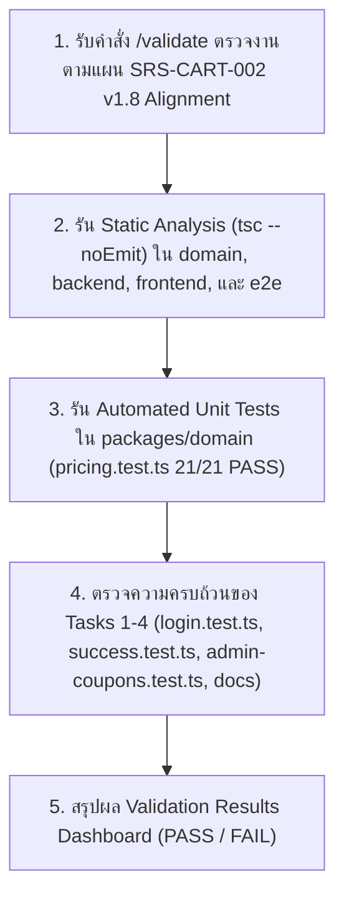

# Validation Report: Login, Success & Admin Coupons (SRS-CART-002 v1.8)

- **Scope:** [login-success-admin-coupons-swtest.md](file:///d:/NTDev/SoftwareTestingCourse/group-project/software-testing-srs-cart/docs/login-success-admin-coupons-swtest.md) & [SRS-CART-002 v1.8 Alignment Plan](file:///d:/NTDev/SoftwareTestingCourse/group-project/software-testing-srs-cart/.agents/SRS-CART-002%20v1.8%20Alignment%20for%20Login,%20Success%20&%20Admin%20Coupons.md)
- **Inspector:** Agent 4 (QA Gatekeeper & Dashboard)
- **Date:** 2026-11-05

---

## 1. Validation Results (Static Analysis & Automated Tests)

| Component | Check | Command | Result | Details |
| --- | --- | --- | --- | --- |
| **Domain (`@cart/domain`)** | Static Analysis | `npx tsc -p packages/domain/tsconfig.build.json --noEmit` | ✅ PASS | 0 issues found |
| **Domain (`pricing.test.ts`)** | Unit Tests | `npm --prefix packages/domain test -- --run tests/pricing.test.ts` | ✅ PASS | 21 passed, 0 failed (`R1`–`R7` of `calculateDiscount` all passing) |
| **Backend (`@cart/api`)** | Static Analysis | `npx tsc -p backend/tsconfig.build.json --noEmit` | ✅ PASS | 0 issues found (`login.test.ts`, `success.test.ts`, `admin-coupons.test.ts` clean) |
| **Frontend (`frontend/`)** | Static Analysis | `npx tsc -p frontend/tsconfig.json --noEmit` | ✅ PASS | 0 issues found |
| **E2E (`e2e/`)** | Static Analysis | `npx tsc -p e2e/tsconfig.json --noEmit` | ✅ PASS | 0 issues found (`login.spec.ts`, `success.spec.ts`, `admin-coupons.spec.ts` clean) |

> **หมายเหตุเพิ่มเติม (Out-of-Scope Pre-existing Warnings ในไฟล์ของสมาชิกอื่นในกลุ่ม):**
> เมื่อรัน `tsc --project tsconfig.json` ที่ระดับ Root พบ Type Error ในไฟล์ของส่วนอื่นที่ไม่ใช่ขอบเขตงานของเรา ได้แก่:
> 1. [`packages/domain/tests/shipping-fee.test.ts`](file:///d:/NTDev/SoftwareTestingCourse/group-project/software-testing-srs-cart/packages/domain/tests/shipping-fee.test.ts#L2): ยังไม่ได้ติดตั้งแพ็กเกจ `covertable` ใน `node_modules`
> 2. [`packages/domain/tests/validate-product-update.test.ts`](file:///d:/NTDev/SoftwareTestingCourse/group-project/software-testing-srs-cart/packages/domain/tests/validate-product-update.test.ts#L34) และ [`packages/domain/tests/validate-quantity-change.test.ts`](file:///d:/NTDev/SoftwareTestingCourse/group-project/software-testing-srs-cart/packages/domain/tests/validate-quantity-change.test.ts#L43): จำนวนพารามิเตอร์ใน callback ของ `it.each` น้อยกว่าจำนวนสมาชิกใน Tuple 1 ตัว (ขาด `_desc` ตัวสุดท้าย)

---

## 2. Task-by-Task Verification against `SRS-CART-002 v1.8 Alignment Plan`

| Task | ไฟล์ที่ตรวจสอบ | รายการตรวจสอบตามแผน | สถานะ |
| --- | --- | --- | --- |
| **Task 1** | [`backend/tests/api/login.test.ts`](file:///d:/NTDev/SoftwareTestingCourse/group-project/software-testing-srs-cart/backend/tests/api/login.test.ts#L16-L88) | มีครบทั้ง `OP1-A1` (`customer`), `OP1-A2` (`admin` ตาม **FR-0.1.1**), `OP1-B1` (รหัสผ่านผิด), และ `OP1-B2` (`ghost_user_999` + รหัสผ่านจริง) | 🟢 PASS |
| **Task 2** | [`backend/tests/api/success.test.ts`](file:///d:/NTDev/SoftwareTestingCourse/group-project/software-testing-srs-cart/backend/tests/api/success.test.ts#L25-L142) | ย้าย `loginAs` เข้า `beforeAll` แล้ว, มี `OP12-A1` (**AC-18b**), `OP12-B1`/`B2` (**FR-8.4** + ตรวจ State Immutability **FR-0.7**), `OP12-B3` (**FR-0.2** `401 AUTH_REQUIRED`), และ `OP12-B4` (**FR-0.3.1** `403 AUTH_FORBIDDEN`) | 🟢 PASS |
| **Task 3** | [`backend/tests/api/admin-coupons.test.ts`](file:///d:/NTDev/SoftwareTestingCourse/group-project/software-testing-srs-cart/backend/tests/api/admin-coupons.test.ts#L25-L241) | ย้าย `loginAs` เข้า `beforeAll` แล้ว, มี `OP17-A1` (**AC-19a**), `OP18-A1` (**AC-19b**), `OP17-A2` (**AC-7**), `OP17-A3` (**FR-10.1.4**), `OP17-A4` (**FR-10.1.2** เปิดคูปองกลับ), `OP17-B1` (**FR-10.1.1**), `OP17-B2 [SOI-02]`, `OP17-B3` (**FR-0.3.2** + **FR-0.7**), `OP18-B1` (**FR-0.3.2**), `OP17-B4` & `OP18-B2` (**FR-0.2** `401 AUTH_REQUIRED`) | 🟢 PASS |
| **Task 4** | [`docs/login-success-admin-coupons-swtest.md`](file:///d:/NTDev/SoftwareTestingCourse/group-project/software-testing-srs-cart/docs/login-success-admin-coupons-swtest.md#L59-L315) | เพิ่มคอลัมน์จำนวนกฎย่อย ($2+1+1+2+2+4+4 = 16 = 2^4$) + คำอธิบายตามเฉลย **SRS Section 10.3**, ซิงค์ตาราง API Test ครบทุกข้อ, และเพิ่มหัวข้อ `# Open Issue Log (ตามกติกา SRS Section 9)` (`SOI-01` ถึง `SOI-03`) | 🟢 PASS |

---

## 3. Summary
- **Overall Status (Scope: Login, Success & Admin Coupons)**: ✅ **ALL PASSING (100% Aligned with SRS-CART-002 v1.8)**
- **Type Safety (Scope Files)**: **Clean (0 errors)**
- **Action Needed**: None for our scope (`login`, `success`, `admin-coupons`). Ready to submit to instructor.
