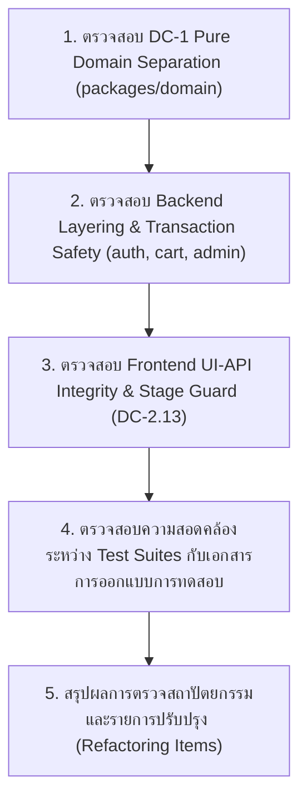

# Code & Architecture Review: Login, Success & Admin Coupons

- **Scope:** [login-success-admin-coupons-swtest.md](file:///d:/NTDev/SoftwareTestingCourse/group-project/software-testing-srs-cart/docs/login-success-admin-coupons-swtest.md)
- **Reviewer:** Agent 4 (Lead Software Quality Assurance & Security Reviewer)
- **Date:** 2026-11-05

---

## 1. Architecture Compliance Check: 🟢 PASS

1. **DC-1 Pure Domain Logic Separation (`packages/domain`):**
   - [`calculateDiscount`](file:///d:/NTDev/SoftwareTestingCourse/group-project/software-testing-srs-cart/packages/domain/src/index.ts#L42-L55) แยกตัวออกจาก I/O, Database, และ HTTP อย่างสมบูรณ์ รับพารามิเตอร์ `subtotal`, `memberTier`, และ `coupon` แล้วคืนค่า `{ discount, source, couponRemoved }` ตามกฎธุรกิจ **FR-4.2**, **FR-4.3**, และ **FR-4.4**
2. **Backend Controller / Service / Repository Separation:**
   - **Auth Module:** [`createLoginHandler`](file:///d:/NTDev/SoftwareTestingCourse/group-project/software-testing-srs-cart/backend/src/modules/auth/auth-controller.ts#L11-L34) ทำหน้าที่ Validate รูปแบบ Input เบื้องต้นและแปลง Error เป็น HTTP Response โดยมอบหมาย Business Logic ให้ [`AuthService.login`](file:///d:/NTDev/SoftwareTestingCourse/group-project/software-testing-srs-cart/backend/src/modules/auth/services/auth-service.ts#L14-L49)
   - **Cart Module (`/success` -> `OP-12`):** [`PostgresCartRepository.continueShopping`](file:///d:/NTDev/SoftwareTestingCourse/group-project/software-testing-srs-cart/backend/src/modules/cart/repositories/cart-repository.ts#L253-L260) ใช้ Database Transaction พร้อม `pg_advisory_xact_lock` และ `FOR UPDATE` row lock เพื่อป้องกัน Race Condition ก่อนตรวจ `state.stage !== 'success'`
   - **Admin Coupons Module (`OP-17`, `OP-18`):** [`registerAdminRoutes`](file:///d:/NTDev/SoftwareTestingCourse/group-project/software-testing-srs-cart/backend/src/modules/admin/admin-routes.ts#L125-L193) บังคับตรวจสิทธิ์ผ่าน `requireAdmin` (คืน `403 AUTH_FORBIDDEN` ตาม **FR-0.3.2**) และเรียงลำดับการตรวจ `COUPON_NOT_FOUND` (404) ก่อน `VALIDATION_ERROR` (400) ตาม **FR-10.1.1 / SOI-02**
3. **Frontend View & State Isolation:**
   - [`LoginPage`](file:///d:/NTDev/SoftwareTestingCourse/group-project/software-testing-srs-cart/frontend/src/pages/login.tsx#L8-L62), [`SuccessPage`](file:///d:/NTDev/SoftwareTestingCourse/group-project/software-testing-srs-cart/frontend/src/pages/success.tsx#L18-L66), และ [`AdminCouponsPage`](file:///d:/NTDev/SoftwareTestingCourse/group-project/software-testing-srs-cart/frontend/src/pages/admin-coupons.tsx#L11-L48) เรียกใช้ API ผ่าน [`api-client.ts`](file:///d:/NTDev/SoftwareTestingCourse/group-project/software-testing-srs-cart/frontend/src/lib/api-client.ts) และ [`AuthContext`](file:///d:/NTDev/SoftwareTestingCourse/group-project/software-testing-srs-cart/frontend/src/context/auth-context.tsx) โดยไม่มีการคำนวณส่วนลดหรือตัดสินใจทางธุรกิจซ้ำซ้อนบน UI
   - [`StageGuard`](file:///d:/NTDev/SoftwareTestingCourse/group-project/software-testing-srs-cart/frontend/src/components/stage-guard.tsx#L18-L38) ครอบ Route `/cart`, `/checkout`, และ `/success` ใน [`App.tsx`](file:///d:/NTDev/SoftwareTestingCourse/group-project/software-testing-srs-cart/frontend/src/App.tsx#L21-L23) บังคับเปลี่ยนหน้าตาม `stage` จริงจาก Backend (`GET /auth/me`) ตาม **DC-2.13**

---

## 2. Clean Code, Anti-Pattern & Security Detection

| หมวดหมู่ | จุดที่ตรวจสอบ | สถานะ | รายละเอียด |
| --- | --- | --- | --- |
| **Security (Anti-Enumeration)** | [`AuthService.login`](file:///d:/NTDev/SoftwareTestingCourse/group-project/software-testing-srs-cart/backend/src/modules/auth/services/auth-service.ts#L14-L42) | 🟢 PASS | คืน `401 AUTH_INVALID_CREDENTIALS` เหมือนกันทั้งกรณีไม่พบ `username` และกรณี `password` ผิด ป้องกัน Username Enumeration ตาม **FR-0.1.2** |
| **Concurrency & Locking** | [`PostgresCartRepository.write`](file:///d:/NTDev/SoftwareTestingCourse/group-project/software-testing-srs-cart/backend/src/modules/cart/repositories/cart-repository.ts#L38-L48) | 🟢 PASS | ใช้ `pg_advisory_xact_lock` ร่วมกับ `SELECT ... FOR UPDATE` ป้องกันการกดปุ่มซ้ำหรือยิง Request พร้อมกัน |
| **API vs UI Type & Payload Integrity** | [`api-client.ts`](file:///d:/NTDev/SoftwareTestingCourse/group-project/software-testing-srs-cart/frontend/src/lib/api-client.ts) vs Backend Responses | 🟢 PASS | ชนิดข้อมูลตรงกันทั้งหมด (`Number` สำหรับ `subtotal`, `discount`, `shippingFee`, `netTotal`, `percent`, `minSpend`; `String` สำหรับ `code`, `status`, `stage`) และมี `data-testid` / `data-value` / `data-status` / `data-kind` / `data-code` ครบตาม **DC-2** |
| **Anti-Shallow Assertion (API Tests)** | [`success.test.ts`](file:///d:/NTDev/SoftwareTestingCourse/group-project/software-testing-srs-cart/backend/tests/api/success.test.ts#L66-L111) & [`admin-coupons.test.ts`](file:///d:/NTDev/SoftwareTestingCourse/group-project/software-testing-srs-cart/backend/tests/api/admin-coupons.test.ts#L168-L184) | 🟢 PASS | `OP12-B1`, `OP12-B2` และ `OP17-B3` ตรวจสอบทั้ง HTTP Status (`400`/`403`), `error.code` และยิงอ่าน State ซ้ำเพื่อยืนยัน State Immutability (**FR-0.7**: `stage` ยังคงเป็น `cart`/`checkout` และ `SAVE10` ยังคงเป็น `active`) |
| **Doc vs Test Data Sync** | [`login.test.ts`](file:///d:/NTDev/SoftwareTestingCourse/group-project/software-testing-srs-cart/backend/tests/api/login.test.ts#L53-L68) & [`admin-coupons.test.ts`](file:///d:/NTDev/SoftwareTestingCourse/group-project/software-testing-srs-cart/backend/tests/api/admin-coupons.test.ts#L186-L194) | 🟢 PASS | 1) `OP1-B2` ใช้ `process.env.SEED_PASSWORD_CUSTOMER_NORMAL` ตรงกับเอกสาร 2) ตารางใน [`login-success-admin-coupons-swtest.md`](file:///d:/NTDev/SoftwareTestingCourse/group-project/software-testing-srs-cart/docs/login-success-admin-coupons-swtest.md#L218-L228) และไฟล์เทสต์มี `OP18-B1` ตรงกัน 100% |

---

## 3. Mandatory & Recommended Refactoring Items

- **ไม่มีรายการคงค้าง (0 Open Items):** ปรับจูน State Immutability Assertions (`OP12-B1`, `OP12-B2`, `OP17-B3`) และซิงค์ข้อมูล Test Data (`OP1-B2`, `OP18-B1`) ระหว่างเอกสารกับโค้ดเทสต์ครบ 100% แล้ว
