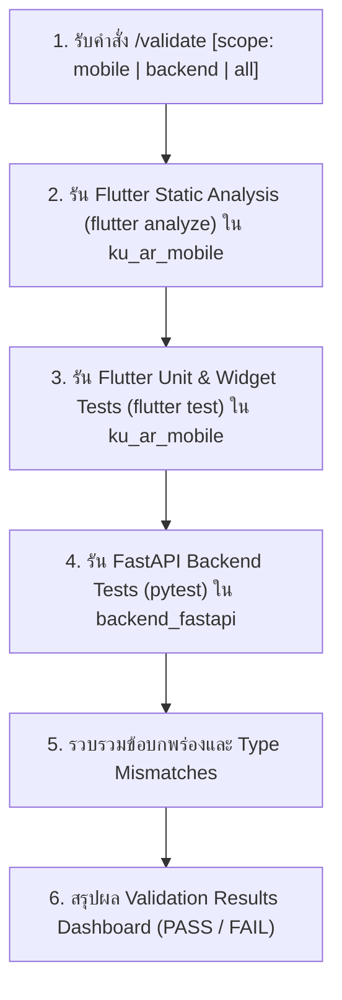

# Validate: Automated Testing & Static Analysis Pipeline

คำสั่งสำหรับตรวจสอบความถูกต้องทางสถาปัตยกรรม (Static Analysis), Type Safety และชุดทดสอบอัตโนมัติ (Automated Tests) ทั้งฝั่ง Flutter Frontend และ FastAPI Backend

---

## Workflow Diagram



---

## Checks to Run

### 1. Flutter Mobile Client (`ku_ar_mobile/`)

```bash
# Static Analysis & Linter
cd ku_ar_mobile ; flutter analyze

# Unit Tests and Widget Tests
cd ku_ar_mobile ; flutter test
```

### 2. FastAPI Backend (`backend_fastapi/`)

```bash
# Backend Automated Tests & Schema Integrity
cd backend_fastapi ; pytest -v
```

---

## Process

1. ตรวจสอบขอบเขตที่ระบุ (`mobile`, `backend` หรือ `all` โดยเริ่มต้นเป็น `all`)
2. ดำเนินการรัน Static Analysis ของ Flutter บันทึกผล Warnings/Errors
3. ดำเนินการรัน Automated Tests ของ Flutter บันทึกจำนวน Passed/Failed
4. ดำเนินการรัน Pytest ของ Backend บันทึกจำนวน Passed/Failed
5. รวบรวมข้อผิดพลาด (ถ้ามี) พร้อมระบุไฟล์และบรรทัดที่เกิดปัญหา
6. แสดงสรุปผลผ่าน Dashboard Report

---

## Output Format

รายงานผลในรูปแบบ Markdown ตารางสรุป:

```markdown
## Validation Results

| Component | Check | Command | Result | Details |
|---|---|---|---|---|
| Mobile | Static Analysis | `flutter analyze` | ✅ / ❌ | {N errors / warnings or "0 issues found"} |
| Mobile | Automated Tests | `flutter test` | ✅ / ❌ | {N passed, M failed} |
| Backend | Unit/API Tests | `pytest` | ✅ / ❌ | {N passed, M failed} |

### Summary
- **Overall Status**: ✅ ALL PASSING / ❌ {N} FAILURES DETECTED
- **Type Safety**: [Clean / Mismatches Detected]
- **Action Needed**: {None / List of files and fixes needed}
```

---

## If Failures Found

แจกแจงรายการข้อผิดพลาดแต่ละจุดอย่างชัดเจน:
1. ไฟล์และบรรทัดที่เกิดปัญหา (`path/to/file.dart:line`)
2. ข้อความ Error / Assertion Failure
3. แนวทางแก้ไขเฉพาะจุด (Surgical Fix)
