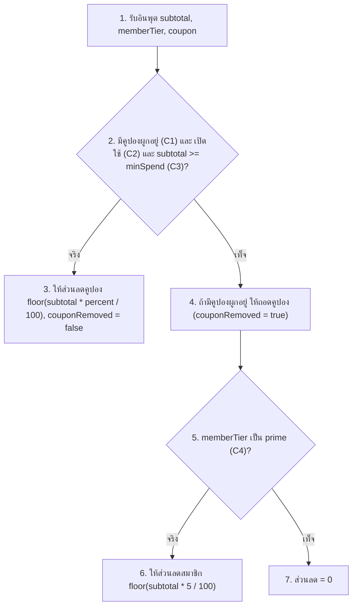
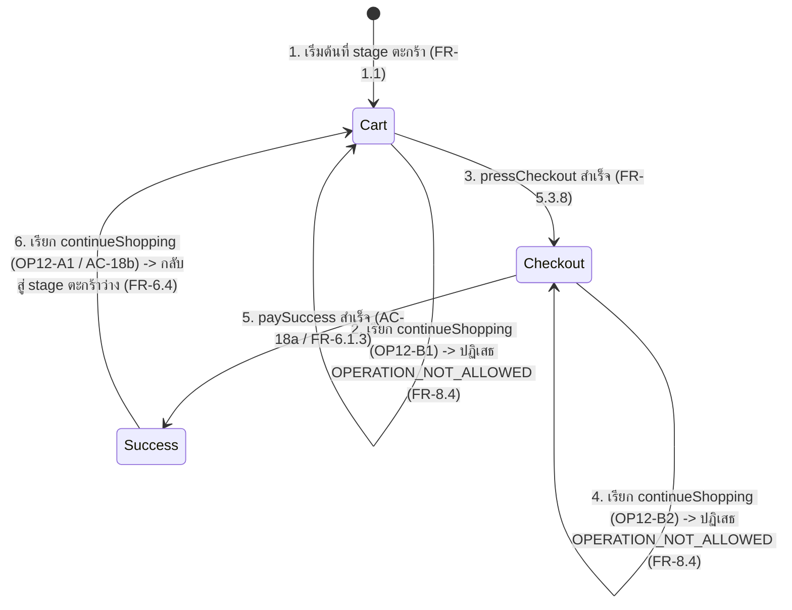
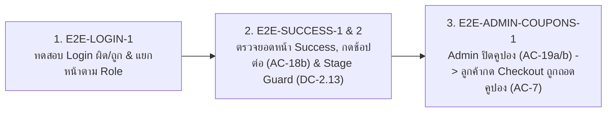

# Login, Success & Admin Coupons

---

# Unit Test

## ภาพรวมการคัดแยก Unit Test ตามข้อกำหนด DC-1
- **ดูจากข้อกำหนดไหน:** **DC-1 (Section 6.1)** กำหนดให้แยก business logic ที่เป็น **pure function** (ไม่อ่าน/เขียนฐานข้อมูล ไม่เรียก HTTP ไม่อ่านเวลา) ออกมาไว้ใน `packages/domain/src/index.ts` จำนวน 10 ฟังก์ชัน
- **ทำไม `/login` (`OP-1`) และ `/success` (`OP-12`) ถึงไม่มี Unit Test ของตัวเอง:** เพราะการทำงานของการเข้าสู่ระบบ (ตรวจสอบรหัสผ่านในฐานข้อมูลและออก token) และการเปลี่ยน `stage` ของลูกค้า (`FR-8`) เป็นการทำงานร่วมกับสถานะในฐานข้อมูล (Stateful & I/O Operations) ไม่ใช่ฟังก์ชันคำนวณบริสุทธิ์ จึงต้องทดสอบในระดับ **API Test (Integration)** และ **E2E**
- **แล้วหน้าไหนในงานของเรามี Unit Test:** หน้า **`/admin/coupons`** (`OP-17 setCouponStatus`) มีความเชื่อมโยงโดยตรงกับ pure function **`calculateDiscount(subtotal, memberTier, coupon)`** ใน `packages/domain/src/index.ts` เพราะการที่ Admin กดเปิดหรือปิดคูปองในหน้า `/admin/coupons` (**FR-10.1.3**) คือตัวกำหนดค่าพารามิเตอร์ `coupon.active` (`true` / `false`) ที่ส่งเข้าฟังก์ชันนี้โดยตรง

---

## 1. calculateDiscount (ส่วนที่เชื่อมกับ `/admin/coupons`)

### 1.1 ดูจาก FR ไหน / Function อะไร / AC ไหน
- **Function ในโค้ด:** `calculateDiscount(subtotal, memberTier, coupon)` ในไฟล์ `packages/domain/src/index.ts`
- **FR ที่เกี่ยวข้อง:**
    - **FR-10.1.3** การเปลี่ยนสถานะคูปองโดย Admin ต้องมีผลต่อการคำนวณ ณ `pressCheckout` ครั้งถัดไป (เชื่อมกับ FR-4.2.1 และ FR-4.3.1)
    - **FR-4.2 ส่วนลดจากคูปอง**
        - **FR-4.2.1** เมื่อมีคูปองผูกอยู่ และคูปองยังมีสถานะ `เปิดใช้` และยอดรวมสินค้า $\ge$ ยอดขั้นต่ำของคูปอง (`minSpend`) ระบบต้องให้ส่วนลดเท่ากับ `floor(ยอดรวมสินค้า × percent / 100)`
        - **FR-4.2.2** เมื่อให้ส่วนลดจากคูปองตาม FR-4.2.1 ระบบต้องไม่ให้ส่วนลดสมาชิกตาม FR-4.4 เพิ่ม (ส่วนลดไม่ทบกัน)
    - **FR-4.3 คูปองที่ใช้ไม่ได้**
        - **FR-4.3.1** เมื่อมีคูปองผูกอยู่ แต่คูปองมีสถานะ `ปิดใช้` หรือยอดรวมสินค้า $<$ ยอดขั้นต่ำของคูปอง ระบบต้องถอดคูปองออกจากตะกร้า (`couponRemoved: true`)
        - **FR-4.3.2** เมื่อถอดคูปองตาม FR-4.3.1 ระบบต้องแจ้ง notice `COUPON_NOT_APPLICABLE` พร้อมข้อความ “คูปองไม่สามารถใช้กับคำสั่งซื้อนี้”
    - **FR-4.4 ส่วนลดสมาชิก** (ใช้เมื่อไม่มีคูปองผูกอยู่ หรือคูปองถูกถอดตาม FR-4.3.1)
        - **FR-4.4.1** ระบบต้องให้ส่วนลดสมาชิกเท่ากับ `floor(ยอดรวมสินค้า × 5 / 100)` แก่ Customer ระดับ `prime`
        - **FR-4.4.2** ระบบต้องให้ส่วนลดเป็นศูนย์แก่ Customer ระดับ `normal`
- **AC ที่เกี่ยวข้อง:** **AC-4**, **AC-5**, **AC-6**, และโดยเฉพาะ **AC-7** (กรณี Admin ปิดคูปอง `SAVE10` หลังลูกค้าผูกคูปองไว้ในตะกร้าแล้ว)

### 1.2 ใช้เทคนิคอะไร และทำไม
1. **Decision Table Testing (แบบ Limited-Entry):**
   - **ทำไมต้องใช้:** เพราะการได้ส่วนลดขึ้นอยู่กับเงื่อนไขทางธุรกิจ 4 ข้อ (`C1` ถึง `C4`) ที่ผูกโยงกันด้วยตรรกะ `AND` และ `OR` (ไม่ได้เป็นอิสระต่อกัน) โดยเฉพาะกรณีที่คูปองถูกผูกไว้ (`C1 = T`) แต่ถูก Admin ปิดใช้ในภายหลัง (`C2 = F`) ซึ่งต้องตรวจสอบว่าจะถอดคูปองและตกไปใช้ส่วนลดสมาชิกตามระดับ `memberTier` (`C4`) หรือไม่
2. **Boundary Value Analysis (BVA — On-point / Off-point):**
   - **ทำไมต้องใช้:** เพราะเงื่อนไข `C3` เป็นอสมการเปรียบเทียบตัวเลข `subtotal >= minSpend` (โดยคูปอง `SAVE10` มี `minSpend = 1000`) ซึ่งเสี่ยงต่อการเกิดบั๊ก **Off-by-one error** (เช่น โปรแกรมเมอร์เขียน `>` แทน `>=`) จึงต้องใช้ BVA ทดสอบจุดขอบที่ `999` (Off-point) และ `1000` (On-point)

### 1.3 คิด Test Case ยังไง (Step-by-step)
1. **ขั้นที่ 1 (ตั้งเงื่อนไขและผลลัพธ์ใน Decision Table):**
   - Condition 4 ข้อ:
     - `C1`: มีคูปองผูกอยู่ (`coupon !== null`)
     - `C2`: คูปองมีสถานะ `เปิดใช้` (`coupon.active === true`)
     - `C3`: ยอดรวมสินค้า $\ge$ `minSpend` (`subtotal >= 1000`)
     - `C4`: `memberTier` เป็น `prime`
   - Action 4 ข้อ:
     - `A1`: ส่วนลดคูปอง = `floor(subtotal * percent / 100)`, `source: 'coupon'`, `couponRemoved: false`
     - `A2`: ถอดคูปอง (`couponRemoved: true`)
     - `A3`: ส่วนลดสมาชิก = `floor(subtotal * 5 / 100)`, `source: 'member'`
     - `A4`: ส่วนลด = `0`, `source: 'none'`
2. **ขั้นที่ 2 (แจกแจงกฎ $2^4 = 16$ Rules และยุบรวมกฎด้วย Don't Care `-`):**
   - เมื่อ `C1, C2, C3` เป็นจริงทั้งหมด (`T, T, T`) ลูกค้าจะได้ส่วนลดคูปองเสมอโดยไม่สนว่าเป็นสมาชิก `prime` หรือ `normal` (`C4 = -`) $\rightarrow$ ยุบเหลือ **Rule 1**
   - เมื่อมีคูปองแต่ถูก Admin ปิดใช้ (`C1 = T, C2 = F`) คูปองจะถูกถอดเสมอโดยไม่สนว่ายอดซื้อจะถึงขั้นต่ำหรือไม่ (`C3 = -`) $\rightarrow$ ยุบเหลือ **Rule 4** (สำหรับ `prime`) และ **Rule 5** (สำหรับ `normal`)
   - เมื่อไม่มีคูปองผูกอยู่เลย (`C1 = F`) ค่าของ `C2` และ `C3` จะไม่มีความหมาย (`-`) $\rightarrow$ ยุบเหลือ **Rule 6** และ **Rule 7**
3. **ขั้นที่ 3 (เลือกค่าตัวเลขทดสอบด้วย BVA รอบจุดขอบ `minSpend = 1000`):**
   - เลือก `subtotal = 1000` (On-point: ถึงเกณฑ์ขั้นต่ำพอดี) สำหรับ Rule 1
   - เลือก `subtotal = 999` (Off-point: ขาดอีก 1 บาทจะถึงเกณฑ์) สำหรับ Rule 2 และ Rule 3
   - เลือก `subtotal = 1999` (เห็นผลปัดเศษ `floor(1999 * 5 / 100) = 99`) สำหรับ Rule 4–7

| Rule | C1 (มีคูปอง) | C2 (เปิดใช้) | C3 ($\ge$ minSpend) | C4 (Prime) | Action |
| --- | --- | --- | --- | --- | --- |
| 1 | T | T | T | - | A1 |
| 2 | T | T | F | T | A2, A3 |
| 3 | T | T | F | F | A2, A4 |
| 4 | T | F | - | T | A2, A3 |
| 5 | T | F | - | F | A2, A4 |
| 6 | F | - | - | T | A3 |
| 7 | F | - | - | F | A4 |

| Rule | subtotal | memberTier | coupon | Expected |
| --- | --- | --- | --- | --- |
| 1 (On-point BVA) | 1000 | prime | 10%, min 1000, เปิดใช้ | `{ discount: 100, source: 'coupon', couponRemoved: false }` |
| 2 (Off-point BVA) | 999 | prime | 10%, min 1000, เปิดใช้ | `{ discount: 49, source: 'member', couponRemoved: true }` |
| 3 (Off-point BVA) | 999 | normal | 10%, min 1000, เปิดใช้ | `{ discount: 0, source: 'none', couponRemoved: true }` |
| 4 (Admin ปิดคูปอง) | 1999 | prime | 10%, min 1000, ปิดใช้ | `{ discount: 99, source: 'member', couponRemoved: true }` |
| 5 (Admin ปิดคูปอง) | 1999 | normal | 10%, min 1000, ปิดใช้ | `{ discount: 0, source: 'none', couponRemoved: true }` |
| 6 (ไม่ผูกคูปอง) | 1999 | prime | null | `{ discount: 99, source: 'member', couponRemoved: false }` |
| 7 (ไม่ผูกคูปอง) | 1999 | normal | null | `{ discount: 0, source: 'none', couponRemoved: false }` |

---

# API Test

## 1. OP-1 login (หน้า `/login`)

### 1.1 ดูจาก FR ไหน / Function อะไร / AC ไหน
- **Operation & Endpoint:** `OP-1 login(username, password)` $\rightarrow$ `POST /auth/login` (ไฟล์ `backend/src/modules/auth/auth-controller.ts` และ `auth-service.ts`)
- **FR ที่เกี่ยวข้อง:**
    - **FR-0.1.1** เมื่อผู้ใช้เรียก `login(username, password)` ด้วย username และ password ที่ตรงกับบัญชีที่ลงทะเบียนไว้ล่วงหน้า ระบบต้องให้ผู้ใช้เข้าสู่ระบบในบทบาทของบัญชีนั้น
    - **FR-0.1.2** เมื่อผู้ใช้เรียก `login(username, password)` ด้วย username หรือ password ที่ไม่ตรงกับบัญชีใด ระบบต้องปฏิเสธด้วย `AUTH_INVALID_CREDENTIALS`
    - **FR-0.7** เมื่อระบบปฏิเสธ operation ใดด้วย domain error code ระบบต้องไม่เปลี่ยนแปลงข้อมูลใดๆ
- **AC ที่เกี่ยวข้อง:** ใน SRS Section 8 ไม่มี AC แยกเฉพาะสำหรับ Login โดยตรง แต่การ Login เป็น Precondition พื้นฐานของทุก AC (และเชื่อมกับความปลอดภัยใน **AC-14**) จึงต้องอ้างอิงจาก **FR-0.1.1** และ **FR-0.1.2** โดยตรง

### 1.2 ใช้เทคนิคอะไร และทำไม
1. **Decision Table แบบ Limited-Entry ร่วมกับ Rule Simplification:**
   - **ทำไมต้องใช้:** เพราะการยืนยันตัวตนประกอบด้วย 2 ตัวแปรที่ต้องตรวจสอบร่วมกัน (ไม่เป็นอิสระต่อกัน) คือ `username` ต้องมีในระบบ **และ** `password` ต้องตรงกับบัญชีนั้น
2. **Propositional Logic & De Morgan's Law (คณิตศาสตร์ไม่ต่อเนื่อง):**
   - **ทำไมต้องใช้:** เงื่อนไขสำเร็จคือ $P \land Q$ ดังนั้นเงื่อนไขล้มเหลวคือ $\neg(P \land Q) \equiv \neg P \lor \neg Q$ ซึ่งบังคับว่าไม่ว่าชื่อผู้ใช้จะผิด ($\neg P$) หรือรหัสผ่านจะผิด ($\neg Q$) ระบบต้องคืนรหัสข้อผิดพลาดเดียวกันคือ `AUTH_INVALID_CREDENTIALS` เพื่อป้องกันช่องโหว่การสุ่มเดาชื่อผู้ใช้ (Username Enumeration)

### 1.3 คิด Test Case ยังไง (Step-by-step)
1. **ขั้นที่ 1 (สร้างตารางการตัดสินใจเต็ม $2^2 = 4$ กฎ):**
   - กำหนด `C1`: `username` ถูก/ผิด, `C2`: `password` ถูก/ผิด
   - กำหนด `A1`: เข้าสู่ระบบสำเร็จในบทบาทของบัญชีนั้น (HTTP 200), `A2`: ปฏิเสธด้วย `AUTH_INVALID_CREDENTIALS` (HTTP 401)
2. **ขั้นที่ 2 (ยุบรวมกฎ — Rule Simplification):**
   - สังเกตว่าใน Rule 3 (`username` ผิด, `password` ถูก) และ Rule 4 (`username` ผิด, `password` ผิด) ให้ผลลัพธ์เป็น `A2` เหมือนกัน เพราะเมื่อไม่พบบัญชีผู้ใช้ตั้งแต่แรก รหัสผ่านจะเป็นอะไรก็ไม่มีผล จึงยุบรวมกันด้วย **Don't Care (`-`)** เหลือ **3 Test Cases** (`OP1-A1`, `OP1-B1`, `OP1-B2`)

| Rule (ก่อนยุบ) | C1 (username) | C2 (password) | Action |
| --- | --- | --- | --- |
| 1 | ถูก | ถูก | A1 |
| 2 | ถูก | ผิด | A2 |
| 3 | ผิด | ถูก | A2 |
| 4 | ผิด | ผิด | A2 |

| Rule (หลังยุบ) | C1 (username) | C2 (password) | Action |
| --- | --- | --- | --- |
| R1 (`OP1-A1`) | ถูก | ถูก | A1 (200 OK + accessToken) |
| R2 (`OP1-B1`) | ถูก | ผิด | A2 (401 + `AUTH_INVALID_CREDENTIALS`) |
| R3 (`OP1-B2`) | ผิด | - (Don't Care) | A2 (401 + `AUTH_INVALID_CREDENTIALS`) |

| ID | Endpoint | เงื่อนไข | Precondition | Test data | Expected |
| --- | --- | --- | --- | --- | --- |
| OP1-A1 | POST /auth/login | Rule 1 (T, T): login สำเร็จด้วยบัญชีที่ถูกต้อง (FR-0.1.1) | มีบัญชี seed `cus_normal` ในระบบ | body: `{"username":"cus_normal","password":"<SEED_PASSWORD_CUSTOMER_NORMAL>"}` | 200 + `data.accessToken` เป็น string, `data.user.username = "cus_normal"`, `data.user.role = "customer"` |
| OP1-B1 | POST /auth/login | Rule 2 (T, F): username มีอยู่จริงแต่ password ผิด (FR-0.1.2) | มีบัญชี seed `cus_normal` ในระบบ | body: `{"username":"cus_normal","password":"wrong_password_999"}` | 401 + `error.code = "AUTH_INVALID_CREDENTIALS"` |
| OP1-B2 | POST /auth/login | Rule 3 (F, -): username ไม่มีในระบบ ไม่ว่า password จะเป็นอะไร (FR-0.1.2) | ไม่มีบัญชี `ghost_user_999` ในระบบ | body: `{"username":"ghost_user_999","password":"<SEED_PASSWORD_CUSTOMER_NORMAL>"}` | 401 + `error.code = "AUTH_INVALID_CREDENTIALS"` |

---

## 2. OP-12 continueShopping (หน้า `/success`)

### 2.1 ดูจาก FR ไหน / Function อะไร / AC ไหน
- **Operation & Endpoint:** `OP-12 continueShopping()` $\rightarrow$ `POST /cart/continue` (ฟังก์ชัน `continueShopping` ใน `backend/src/modules/cart/repositories/cart-repository.ts`)
- **FR ที่เกี่ยวข้อง:**
    - **FR-6.4** เมื่อ Customer เรียก `continueShopping()` ขณะอยู่ stage `สำเร็จ` ระบบต้องเปลี่ยน Customer ไปสู่ stage `ตะกร้า`
    - **FR-8.4** ระบบต้องไม่ประมวลผล `continueShopping` ขณะ Customer อยู่ stage `ตะกร้า` หรือ `ชำระเงิน`
    - **FR-8.5.1** เมื่อระบบไม่ประมวลผล operation ตาม FR-8.1 ถึง FR-8.4 ระบบต้องปฏิเสธด้วย `OPERATION_NOT_ALLOWED`
    - **FR-0.7** เมื่อปฏิเสธด้วย domain error code ข้อมูลทุกอย่างต้องไม่เปลี่ยนแปลง
- **AC ที่เกี่ยวข้อง:**
    - **AC-18b (FR-6.4):** Given `cus_normal` อยู่ stage `สำเร็จ` $\rightarrow$ When เรียก `continueShopping()` $\rightarrow$ Then `cus_normal` อยู่ stage `ตะกร้า` ที่มีจำนวนรายการเป็นศูนย์ (ต่อยอดจาก **AC-18a** ที่ `paySuccess` พาเข้าสู่ stage `สำเร็จ`)

### 2.2 ใช้เทคนิคอะไร และทำไม
- **ใช้เทคนิค Finite State Machine (FSM Testing — State & Transition Coverage):**
  - **ทำไมต้องใช้:** เพราะ `continueShopping()` ไม่มีพารามิเตอร์อินพุตใดๆ ส่งเข้ามาใน body เลย ผลลัพธ์ของการเรียกจะสำเร็จหรือล้มเหลวขึ้นอยู่กับ **"สถานะปัจจุบัน (`stage`) ของลูกค้า"** เพียงอย่างเดียว (Stateful Testing)
  - ตามหลัก **Feedback Loop** ตัวแปร `stage` $\in \{\text{ตะกร้า}, \text{ชำระเงิน}, \text{สำเร็จ}\}$ เป็นตัวแปรสถานะ จึงต้องออกแบบเทสให้ครอบคลุมทั้ง **Valid Transition** (เรียกจาก stage `สำเร็จ`) และ **Invalid Transitions / Sneak Paths** (เผลอเรียกจาก stage `ตะกร้า` หรือ `ชำระเงิน`)

### 2.3 คิด Test Case ยังไง (Step-by-step)
1. **ขั้นที่ 1 (ระบุสถานะตั้งต้นทั้งหมดของ `stage`):** ลูกค้าสามารถอยู่ใน `stage` ได้ 3 สถานะ คือ `ตะกร้า (cart)`, `ชำระเงิน (checkout)`, และ `สำเร็จ (success)`
2. **ขั้นที่ 2 (ยิง event `continueShopping()` ในครบทุกสถานะ):**
   - จาก `stage = success` $\rightarrow$ เป็น Valid Transition ต้องเปลี่ยนกลับไป `stage = cart` และตะกร้าว่าง (`OP12-A1` / **AC-18b**)
   - จาก `stage = cart` $\rightarrow$ เป็น Invalid Transition ต้องถูกปฏิเสธด้วย `OPERATION_NOT_ALLOWED` (`OP12-B1`)
   - จาก `stage = checkout` $\rightarrow$ เป็น Invalid Transition ต้องถูกปฏิเสธด้วย `OPERATION_NOT_ALLOWED` และออเดอร์ยังรอชำระเหมือนเดิม (`OP12-B2`)

| ID | Endpoint | เงื่อนไข | Precondition | Test data | Expected |
| --- | --- | --- | --- | --- | --- |
| OP12-A1 | POST /cart/continue | กลับสู่ตะกร้าหลังสั่งซื้อสำเร็จ (AC-18b, FR-6.4) | `cus_normal` เพิ่ม P1 × 1, กด checkout และ gateway เรียก `paySuccess` จนอยู่ stage `สำเร็จ` | header: token `cus_normal` | 200 + `data.stage = "cart"`, `data.lineCount = 0`, `data.couponCode = null` |
| OP12-B1 | POST /cart/continue | เรียก `continueShopping` ขณะอยู่ stage `ตะกร้า` (FR-8.4, FR-8.5.1) | `cus_normal` อยู่ stage `ตะกร้า` (เริ่มต้น) | header: token `cus_normal` | 400 + `error.code = "OPERATION_NOT_ALLOWED"`, stage ยังเป็น `cart` |
| OP12-B2 | POST /cart/continue | เรียก `continueShopping` ขณะอยู่ stage `ชำระเงิน` (FR-8.4, FR-8.5.1) | `cus_normal` เพิ่ม P1 × 1 แล้วกด checkout จนอยู่ stage `ชำระเงิน` | header: token `cus_normal` | 400 + `error.code = "OPERATION_NOT_ALLOWED"`, stage ยังเป็น `checkout` |

---

## 3. OP-17 setCouponStatus และ OP-18 listCoupons (หน้า `/admin/coupons`)

### 3.1 ดูจาก FR ไหน / Function อะไร / AC ไหน
- **Operations & Endpoints:**
    - `OP-17 setCouponStatus(code, status)` $\rightarrow$ `POST /admin/coupons/:code/status`
    - `OP-18 listCoupons()` $\rightarrow$ `GET /admin/coupons`
    - อยู่ในไฟล์ `backend/src/modules/admin/admin-routes.ts`
- **FR ที่เกี่ยวข้อง:**
    - **FR-10.1.1** เมื่อ Admin เรียก `setCouponStatus(code, status)` ด้วย `code` ที่ไม่มีอยู่ ระบบต้องปฏิเสธด้วย `COUPON_NOT_FOUND`
    - **FR-10.1.2** เมื่อ Admin เรียก `setCouponStatus(code, status)` ด้วย `code` ที่มีอยู่ ระบบต้องเปลี่ยนสถานะของคูปองตามที่ระบุ
    - **FR-10.1.3** การเปลี่ยนสถานะคูปองต้องมีผลต่อการคำนวณ ณ `pressCheckout` ครั้งถัดไป (FR-4.2.1, FR-4.3.1)
    - **FR-10.1.4** การเปลี่ยนสถานะคูปองต้องไม่มีผลกับออเดอร์ที่สร้างแล้ว
    - **FR-10.2** เมื่อ Admin เรียก `listCoupons()` ระบบต้องแสดงคูปองทั้งหมดในระบบ พร้อม `code`, `percent`, `minSpend` และสถานะ (`เปิดใช้` / `ปิดใช้`) ณ ขณะนั้น
    - **FR-0.3.2** ระบบต้องปฏิเสธ OP-15 ถึง OP-18 ที่เรียกโดยผู้ใช้ที่ไม่ใช่ Admin ด้วย `AUTH_FORBIDDEN`
- **AC ที่เกี่ยวข้อง:**
    - **AC-19a (FR-10.1.2):** `admin01` เรียก `setCouponStatus(SAVE10, ปิดใช้)` $\rightarrow$ เปลี่ยนสถานะของ `SAVE10` เป็น `ปิดใช้` (`inactive`)
    - **AC-19b (FR-10.2):** `admin01` เรียก `listCoupons()` หลังปิดใช้ $\rightarrow$ แสดง `SAVE10` ที่มี `percent = 10`, `minSpend = 1000`, และสถานะ `ปิดใช้` (`inactive`)
    - **AC-7 (FR-4.3.1, FR-4.3.2, FR-4.4.2, FR-10.1.3 — ข้าม Actor):** `cus_normal` ผูก `SAVE10` ไว้ในตะกร้าที่มี P2 × 1 (1,200 บาท) $\rightarrow$ `admin01` ปิดใช้ `SAVE10` $\rightarrow$ `cus_normal` กด `pressCheckout(inCity, standard)` $\rightarrow$ ระบบถอดคูปองพร้อมแจ้ง notice `COUPON_NOT_APPLICABLE`, ส่วนลด 0, ค่าส่ง 30, ยอดสุทธิ 1,230

### 3.2 ใช้เทคนิคอะไร และทำไม
1. **Equivalence Class Partitioning (ECP แบบ Weak Robust):**
   - **ทำไมต้องใช้:** เพราะ `setCouponStatus` รับพารามิเตอร์ `code` และ `status` รวมถึงสิทธิ์ผู้เรียก (`role`) ซึ่งสามารถแบ่งกลุ่มข้อมูลที่ถูกต้อง (Valid Partitions) และข้อมูลที่ผิดเงื่อนไขทีละตัว (Invalid Partitions — Single-fault assumption) เพื่อดักจับ Error Code เฉพาะของแต่ละความผิดพลาดได้ครบถ้วน
2. **State Transition & Cross-Actor Side-Effect Testing:**
   - **ทำไมต้องใช้:** เพราะสถานะของคูปอง (`active` $\rightleftharpoons$ `inactive`) เป็นตัวแปรสถานะที่ส่งผลข้ามบทบาทไปยังลูกค้า (ตาม **FR-10.1.3** และ **FR-10.1.4**) จึงต้องทดสอบทั้งกรณีที่ปิดคูปอง**ก่อน**ลูกค้ากด checkout (**AC-7**) และกรณีที่ปิดคูปอง**หลัง**ลูกค้าสร้างออเดอร์ไปแล้ว (Snapshot Immutability)

### 3.3 คิด Test Case ยังไง (Step-by-step)
1. **ขั้นที่ 1 (แบ่ง Partition ของ Input ด้วย ECP Weak Robust):**
   - บทบาทผู้เรียก (`Role`):
     - `R1 (Valid)`: `Admin` (`admin01`)
     - `R2 (Invalid)`: ไม่ใช่ Admin (`cus_normal`) $\rightarrow$ คาดหวัง `AUTH_FORBIDDEN` (**FR-0.3.2**)
   - รหัสคูปอง (`code`):
     - `C1 (Valid)`: รหัสที่มีในระบบ (`SAVE10`)
     - `C2 (Invalid)`: รหัสที่ไม่มีในระบบ (`NO_SUCH`) $\rightarrow$ คาดหวัง `COUPON_NOT_FOUND` (**FR-10.1.1**)
   - สถานะคูปอง (`status`):
     - `S1 (Valid)`: อยู่ในรายการ (`'active'`, `'inactive'`)
     - `S2 (Invalid)`: ไม่อยู่ในรายการ (`'disabled'`) $\rightarrow$ คาดหวัง `VALIDATION_ERROR`
2. **ขั้นที่ 2 (ตรวจสอบ Observability & Cross-Actor Impact):**
   - เมื่อเปลี่ยนสถานะด้วย `OP17-A1` (**AC-19a**) แล้ว ต้องเรียก `OP18-A1` (`GET /admin/coupons` ตาม **AC-19b**) เพื่อยืนยันว่าข้อมูลที่อ่านกลับมาจากระบบเปลี่ยนจริง
   - ทดสอบผลกระทบต่อลูกค้า 2 จังหวะ คือ ปิดคูปองก่อนลูกค้ากด checkout (`OP17-A2` / **AC-7**) และปิดคูปองหลังลูกค้า checkout สร้างออเดอร์ไปแล้ว (`OP17-A3` / **FR-10.1.4**)

| ID | Endpoint | เงื่อนไข | Precondition | Test data | Expected |
| --- | --- | --- | --- | --- | --- |
| OP17-A1 | POST /admin/coupons/SAVE10/status | Admin ปิดใช้คูปอง SAVE10 (AC-19a, FR-10.1.2) | `admin01` login แล้ว และ `SAVE10` มีสถานะ `active` | header: token `admin01`; body: `{"status":"inactive"}` | 200 + `data.coupons` แสดง `SAVE10` มี `status = "inactive"` |
| OP18-A1 | GET /admin/coupons | Admin ดูรายการคูปองทั้งหมดหลังปิดใช้ (AC-19b, FR-10.2) | ทำ OP17-A1 แล้ว (`SAVE10` มีสถานะ `inactive`) | header: token `admin01` | 200 + `data.coupons` มี `{ code: "SAVE10", percent: 10, minSpend: 1000, status: "inactive" }` |
| OP17-A2 | POST /cart/checkout | Admin ปิดใช้คูปองหลังลูกค้าผูกไว้ → ถอดคูปองตอน checkout (AC-7, FR-10.1.3) | `cus_normal` มี P2 × 1 (1,200 บาท) ผูก `SAVE10` แล้ว `admin01` ตั้ง `SAVE10` เป็น `inactive` | header: token `cus_normal`; body: `{"zone":"inCity","speed":"standard"}` | 201 + `messages` มี `code = "COUPON_NOT_APPLICABLE"`, `order.discount = 0`, `order.shippingFee = 30`, `order.netTotal = 1230` |
| OP17-A3 | GET /orders/{orderId} | การปิดคูปองไม่มีผลกับออเดอร์ที่สร้างไปแล้ว (FR-10.1.4) | `cus_normal` มี P2 × 1 + `SAVE10` กด checkout ได้ออเดอร์ X (ส่วนลด 120) แล้ว `admin01` ปิดใช้ `SAVE10` | header: token `cus_normal`; path: `orderId` X | 200 + `data.discount = 120`, `data.netTotal = 1110`, `data.couponCode = "SAVE10"` (ไม่เปลี่ยน) |
| OP17-B1 | POST /admin/coupons/NO_SUCH/status | เปลี่ยนสถานะคูปองที่ไม่มีในระบบ (FR-10.1.1) | `admin01` login แล้ว | header: token `admin01`; body: `{"status":"inactive"}` | 404 + `error.code = "COUPON_NOT_FOUND"` |
| OP17-B2 | POST /admin/coupons/SAVE10/status | ส่งค่า status ที่ไม่อยู่ใน enum (VALIDATION_ERROR) | `admin01` login แล้ว | header: token `admin01`; body: `{"status":"disabled"}` | 400 + `error.code = "VALIDATION_ERROR"` |
| OP17-B3 | POST /admin/coupons/SAVE10/status | Customer เรียกตั้งสถานะคูปองของ Admin (FR-0.3.2) | `cus_normal` login แล้ว | header: token `cus_normal`; body: `{"status":"inactive"}` | 403 + `error.code = "AUTH_FORBIDDEN"`, สถานะ `SAVE10` ยังเป็น `active` |

---

# E2E

## วิธีคิดและการออกแบบ E2E Test (Playwright)
- **ดูจากข้อกำหนดไหน:** อ้างอิง **Section 6.2 (DC-2.1 ถึง DC-2.13)** ซึ่งกำหนด `data-testid`, `data-value`, `data-status`, `data-kind`, `data-code` และกฎการเปลี่ยนหน้าตาม `stage` ของผู้ใช้
- **ใช้เทคนิคอะไร และทำไม:** ใช้ **User Journey & Scenario-Based Testing** ร่วมกับ **FSM Stage Guard Verification** เพื่อจำลองพฤติกรรมผู้ใช้จริงบนเบราว์เซอร์ ตั้งแต่การกรอกฟอร์ม การอ่านข้อความแจ้งเตือน (`app-message`) การตรวจสอบค่าตัวเลขบนหน้าจอ ไปจนถึงการทำงานข้ามบทบาทระหว่าง `Customer` และ `Admin`

## **E2E-LOGIN-1: login ไม่สำเร็จแสดง error และ login สำเร็จพาไปหน้าที่ตรงตามบทบาท (FR-0.1.1, FR-0.1.2)**

`e2e/login.spec.ts`

- เปิด `/login` แล้วกรอก `login-username` = `cus_normal` และ `login-password` = `wrong_password` จากนั้นกด `login-submit`
    - เช็คว่ายังอยู่ที่ `page-login`
    - เช็คว่า `app-message` มี `data-kind` = `error` และ `data-code` = `AUTH_INVALID_CREDENTIALS` (FR-0.1.2)
- กรอก `login-username` = `cus_normal` และรหัสผ่านที่ถูกต้อง แล้วกด `login-submit`
    - เช็คว่าระบบพาไปที่ `page-products` (FR-0.1.1 บทบาท Customer)
- เปิด `/login` ใหม่แล้ว login ด้วย `admin01`
    - เช็คว่าระบบพาไปที่ `page-admin-products` (FR-0.1.1 บทบาท Admin)

## **E2E-SUCCESS-1: จ่ายเงินสำเร็จแสดงข้อมูลออเดอร์ครบถ้วน → กดช้อปปิ้งต่อกลับสู่หน้าตะกร้าว่าง (AC-18a, AC-18b, FR-6.1.4)**

`e2e/success.spec.ts`

- login `cus_normal` เพิ่ม P2 × 1 (1,200 บาท) ผูกคูปอง `SAVE10` กดชำระเงิน (`inCity`, `standard`) แล้วกด `gateway-pay-success`
    - เช็คว่าเห็น `page-success` และ `success-order-id` (AC-18a)
    - เช็คว่าเห็น `success-line-P2`, `success-subtotal` (`data-value` = `1200`), `success-discount` (`data-value` = `120`), `success-shipping` (`data-value` = `30`), `success-total` (`data-value` = `1110`) (FR-6.1.4)
- กดปุ่มช้อปปิ้งต่อ (`continue-shopping-button`)
    - เช็คว่าระบบพาไปที่ `page-cart` และไม่มีรายการสินค้าในตะกร้า (`cart-subtotal` มี `data-value` = `0`, ปุ่ม `checkout-button` มีสถานะ `disabled`) (AC-18b, FR-6.4)

## **E2E-SUCCESS-2: เปิด /cart ตอนอยู่ stage สำเร็จ ระบบบังคับแสดงหน้า page-success (DC-2.13)**

`e2e/success.spec.ts`

- login `cus_normal` เพิ่ม P1 × 1 กดชำระเงิน แล้วกด `gateway-pay-success` จนอยู่ที่ `page-success` (stage `สำเร็จ`)
- พิมพ์ URL `/cart` เอง
    - เช็คว่าระบบพาไปที่ `page-success` แทน (DC-2.13)

## **E2E-ADMIN-COUPONS-1: admin ปิดใช้คูปอง SAVE10 → ลูกค้าที่ผูกคูปองไว้กด checkout ถูกถอดคูปองพร้อมแจ้ง notice (AC-19a, AC-19b, AC-7)**

`e2e/admin-coupons.spec.ts`

- login `cus_normal` เพิ่ม P2 × 1 (1,200 บาท) ไปหน้าตะกร้าแล้วผูกคูปอง `SAVE10` สำเร็จ (`cart-coupon-code` แสดง `SAVE10`)
- logout แล้ว login เป็น `admin01` ไปที่หน้า `/admin/coupons` (`nav-admin-coupons`)
    - เช็คว่าเห็น `page-admin-coupons` และแถว `admin-coupon-row-SAVE10` มี `admin-coupon-percent` (`data-value` = `10`), `admin-coupon-min-spend` (`data-value` = `1000`), `admin-coupon-status` (`data-status` = `active`) (FR-10.2)
- กดปุ่ม `admin-coupon-toggle-status` ในแถว `admin-coupon-row-SAVE10`
    - เช็คว่า `admin-coupon-status` เปลี่ยนเป็น `data-status` = `inactive` (AC-19a, AC-19b)
- logout แล้ว login กลับเป็น `cus_normal` ไปที่หน้าตะกร้า แล้วกด `checkout-button` (`inCity`, `standard`)
    - เช็คว่าเห็น `page-checkout`
    - เช็คว่า `app-message` มี `data-kind` = `notice` และ `data-code` = `COUPON_NOT_APPLICABLE`
    - เช็คว่า `checkout-discount` มี `data-value` = `0`, `checkout-shipping` มี `data-value` = `30`, และ `checkout-total` มี `data-value` = `1230` (AC-7)
